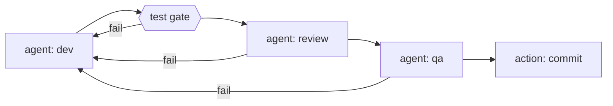

# agentic-dev-loop

> **Turn an LLM into a gated, sandboxed, resumable construction loop over your codebase.**

Describe your pipeline in one YAML file - agent steps, mechanical test gates, and
trusted actions - and `agentic-dev-loop` runs it end to end: agent and command steps get
kernel-level sandboxing via Docker, verdicts route the graph, every boundary is
checkpointed, and nothing gets committed until every gate passes.


- **A tool, not a wiring project.** One CLI entry point, opinionated defaults,
  fixed safety policies. You write the pipeline and the agent definitions -
  nothing else.
- **Deterministic.** Same pipeline + same state → same routing. Verdicts are
  parsed from files, retries are bounded, nothing is best-effort.
- **Sandboxed by default.** The agent's shell and every command step run inside
  an always-on Docker sandbox. There is no opt-out.

## How it fits together

The loop is five layers. You author the first two; the engine owns the rest.

| Layer | What it is | Who authors it |
| --- | --- | --- |
| **Pipeline** | One `pipeline.yaml` declaring the stage graph: agent steps, mechanical command gates, verdict routing, retry loops, and per-step isolation. | You |
| **Agent prompts** | Markdown prompt files with YAML frontmatter (`<name>.agent.md`) defining each agent's role, rules, sandbox notes, and tools. | You |
| **Sandbox** | Every agent shell and command step runs in a Docker container: no network access by default, writes only to declared `mounts:`, and no `.git` - steps run against a fresh export. If no sandbox is available, the run stops instead of degrading. | Engine |
| **Dev image** | The digest-pinned dev image pulled on first run. The supply-chain check refuses to continue on a digest mismatch. | Engine |
| **Extensions** | Optional plugins: your own actions, tools, and document loaders, loaded from outside the workspace. | You (optional) |

Every run is crash-safe (interrupt and resume from the exact checkpoint),
watchable in a live browser graph view with a browsable run history, and
gated: nothing gets committed until every stage passes. The fixed policies are part of the product - fail
fast on missing config or secrets, no silent fallbacks, verdicts only from
artifacts, bounded retries, and a single clean-worktree-gated commit point.

## Supported platforms

The engine is plain Linux under the hood and runs wherever a compliant
Docker engine does:

| Platform | Support |
| --- | --- |
| **Linux** | Native. Docker Engine, OrbStack, Colima, or podman with docker compat. |
| **macOS** | Native. Docker Desktop, OrbStack, or Colima. |
| **Windows** | Via **WSL2** (Ubuntu distro). Enable Docker Desktop's WSL integration (or run Docker Engine inside the distro) and keep the repo on the WSL filesystem (`~/dev/...`), not `/mnt/c` - bind-mounting a 9p path into containers breaks permissions and is slow. |

## Quick start

**Prerequisites**

| Requirement | Detail |
| --- | --- |
| Python | ≥ 3.12 |
| Docker engine | Engine API ≥ 1.43 (Engine 24). Any compliant engine works - Docker Desktop, OrbStack, Colima, Rancher Desktop, podman docker-compat. On Windows, run under WSL2: the repo must live on the WSL filesystem, not /mnt/c. |
| LLM API key | The env var named by your pipeline's `api_key_env` (e.g. `OPENAI_API_KEY`) must be set - a missing key fails fast, naming it. Alternatively, `agentic-dev-loop copilot-login` authenticates a Copilot subscription (see [LLM providers](#llm-providers)). |

```bash
pipx install agentic-dev-loop
agentic-dev-loop --version
```

Install with **pipx**: the engine's venv lives outside the workspace, so it
is unmounted from the sandbox and never agent-writable. On the first run the
engine pulls the digest-pinned dev image and verifies its digest. Setup
details and troubleshooting live in [docs/setup.md](docs/setup.md).

```bash
cd <your-repo>
agentic-dev-loop init --profile python                     # writes the pipeline + agents (see below)
export OPENAI_API_KEY=...                                  # whatever api_key_env names
agentic-dev-loop agentic-dev-loop/pipeline.yaml --dry-run  # validate - no LLM, no Docker
agentic-dev-loop agentic-dev-loop/pipeline.yaml            # run it
```

## Running a pipeline

| Flag | Effect |
| --- | --- |
| `--dry-run` | Full load-and-validate pass, then print the resolved plan. No LLM, no Docker, no state writes, no API key. Exit `0` on a clean load. |
| `--resume <thread-id>` | Continue the latest checkpoint of a previous run (crash, Ctrl-C, exhaustion) with all accumulated notes intact. |
| `--max-attempts <n>` | Override the pipeline's `max_attempts`. |
| `--no-viz` / `--viz-port <port>` | Suppress the live graph view / set a preferred port (default 8321; falls back to a free port when busy). |

Exit code is `0` on pipeline success, `1` otherwise.

Other commands:

- `agentic-dev-loop run-status <pipeline>` renders the latest run as a
  mermaid flowchart with the current step highlighted, reading the run-state
  checkpoint database directly. `run-status --install` installs the bundled
  `/run-status` command into OpenCode.
- `agentic-dev-loop report [<run-id>]` renders accumulated run history as
  ASCII markdown: an aggregate dashboard by default (loop health, TDD,
  review, and QA metrics with provenance labels) or a deep dive for one
  12-hex run directory. `--since` / `--until` / `--status` filter the set.
  Reporting is strictly read-only.
- The live viz also serves a **historical runs view**: click **History** in
  the graph page header (or open `/runs`), or launch it standalone with
  `python -m agentic_dev_loop.viz --history`, which needs no pipeline file
  (default port 8321, falling back to a free port when busy). It lists past
  runs with since / until / status filters, an aggregate metrics panel, and
  a per-run detail page carrying the brief, implementation summary, review
  findings, and QA report.
- `agentic-dev-loop containers` inspects the engine's sandbox containers and
  networks from the host; `containers --reap` removes registry-owned orphans
  whose owner process is dead. A SIGTERM to a running pipeline still closes
  the sandbox; SIGKILLed runs are reclaimed by the startup reaper on the next
  run or by `containers --reap`.

**What a run looks like** (the shipped self-loop example):



1. **dev** - the dev agent works with full context (loaded docs + shared files).
   Its edits are untracked; only declared `produces:` files are hygiene-tracked.
2. **test** - a mechanical command step runs the suite inside the sandbox.
   Exit 0 moves on; anything else rewinds to `dev` with the failing output.
3. **review / qa** - verdict agents finish by calling the `record_verdict`
   tool; the validated tool call routes the graph. `fail` rewinds to `dev`
   and consumes an attempt.
4. **commit** - the single commit point fires only when all gates passed and
   the worktree was clean at start.
5. **success** - committed; or **failure** when attempts are exhausted.

## LLM providers

The engine speaks OpenAI-compatible wire format throughout, so every step,
profile, and gate works identically on either provider style:

| Provider | Setup |
| --- | --- |
| **Any OpenAI-compatible endpoint** | API key via `api_key_env` + `base_url` in the `llm:` block: DeepSeek, OpenAI, or any OpenAI-compatible API. |
| **GitHub Copilot subscription** | `agentic-dev-loop copilot-login` once, then point the `llm:` block at `https://api.githubcopilot.com` with the file-backed token. |

```yaml
# OpenAI-compatible endpoint (any provider)
llm:
  model: openai/deepseek-v4-pro
  base_url: https://api.deepseek.com
  api_key_env: OPENAI_API_KEY
```

```yaml
# GitHub Copilot subscription
llm:
  model: openai/gpt-5.6-luna        # pro tier; gpt-4.1 is the lite tier
  base_url: https://api.githubcopilot.com
  api_key_secret:
    from: file
    key: ~/.agentic-dev-loop/auth/copilot.json
    json_key: access_token
  headers:
    Copilot-Integration-Id: vscode-chat
    Editor-Version: vscode/1.94.0
    Openai-Intent: conversation-panel
```

Copilot specifics:

- The `openai/` prefix on model names is required - it forces the
  OpenAI-compatible route through the gateway.
- `gpt-4.1` (lite tier) rejects any `reasoning_effort`, so lite-tier steps
  set none.
- Some models on this endpoint do not work for agent steps. The current
  working set, the token lifecycle, and known endpoint limitations are in
  [docs/setup.md](docs/setup.md).

## pipeline.yaml

```yaml
name: my-construction-loop
extensions:
  - agentic_dev_loop.engine.extensions.aidlc:AidlcExtension   # bundled AI-DLC doc loader
additional_files:
  - ../README.md                                       # shared context for every agent step

llm:
  model: openai/deepseek-v4-pro
  base_url: https://api.deepseek.com
  api_key_env: OPENAI_API_KEY
  # reasoning_effort: medium                        # optional: low | medium | high | xhigh | none

# Named LLM profiles: a step names one with `llm: <name>` to move the whole
# profile (model, endpoint, key, effort default) together. The `llm:` block
# above remains the default.
# llms:
#   review:
#     model: openai/deepseek-v4-pro
#     base_url: https://api.deepseek.com
#     api_key_env: REVIEW_API_KEY
#     reasoning_effort: xhigh

max_attempts: 10                                        # CLI --max-attempts overrides
agents_dir: sdk_agents                                  # your <name>.agent.md files

steps:
  - name: brief
    reasoning_effort: medium
    brief_inputs:
      include: [AGENTS.md, coding-standards-ddd.yaml]
      sections: [Repo rules digest, Unit scope digest, Environment facts, Open risks]
      env_facts: ["the workspace is an export with no .git; verify with find/ls, never git status"]
    on_pass: dev

  - name: dev
    agent: dev
    produces: implementation-summary.md
    terminal_timeout: 900
    # forbidden_commands: ["npm install", "npm ci"]      # per-step tool deny-list; engine defaults are git mutations + docker
    on_pass: test

  - name: test
    command: .venv-sandbox/bin/python -m pytest tests/ -q -m "not docker"
    setup: python -m venv .venv-sandbox && .venv-sandbox/bin/pip install -e ".[dev]"
    timeout: 600
    on_pass: review
    on_fail: { goto: dev, retry: true }

  - name: review
    agent: review
    artifact: review-findings.md
    verdicts: { pass: APPROVED, fail: NEEDS CHANGES }
    # reasoning_effort: xhigh                        # per-step override of the effective profile's effort
    # llm: review                                    # select a named `llms:` profile for this step
    on_pass: qa
    on_fail: { goto: dev, retry: true }

  - name: qa
    agent: qa
    artifact: qa-report.md
    verdicts: { pass: PASS, fail: FAIL }
    max_iterations: 100
    finalize_nudge_turns: 10
    on_pass: commit
    on_fail: { goto: dev, retry: true }

  - name: commit
    action: commit
    params: { message: "feat: construct {subject} (agent dev loop)" }
```

| Key | Notes |
| --- | --- |
| `agent:` / `command:` / `action:` / `brief_inputs:` | Exactly one per step. Agents live in `agents_dir` as `<name>.agent.md`; commands run sandboxed (mechanical, never an LLM call). `commit` is the sole host-side built-in action; consumer actions are sandbox-executed scripts (see [Host boundary](#host-boundary-security-model)). |
| `produces:` / `artifact:` + `verdicts:` | Hygiene-tracked outputs vs structured-verdict routing. The verdict comes from a validated `record_verdict` tool call, never from prose; stale artifacts are deleted at each attempt start. |
| `brief_inputs:` | A native brief step: `{ include: [<paths/globs>], env_facts: [<strings>], sections: [<headings>] }`. It digests the included docs into an engine-owned `attempt-brief.md` that later agents read, and re-runs only when its inputs change. |
| `on_pass:` / `on_fail:` | A step name, terminal `success`/`failure`, or `{goto: X, retry: true}`. No loops happen unless you write them. |
| `env:` / `setup:` / `network:` | `env:` declares step vars (fixed safe base + declared vars only); `setup:` runs fresh at every step boundary in a one-shot provision container targeting the export (command or agent steps; network ON); `network: true` grants egress scoped by `egress:` (default off) - see [Per-stage networking](#per-stage-networking). |
| `mounts:` / `egress:` | Per-step workspace isolation. `mounts:` lists `{path, mode}` entries (`rw`/`ro`, default `ro`), strict-by-default: empty/missing mounts nothing, and only declared-rw paths sync back to the repo. `egress:` names the hosts a networked step may reach (`{class, presets, targets}`). See [docs/setup.md](docs/setup.md). |
| `secrets:` (top-level) / step `secrets:` | Declares secret **refs only - never values**; each step opts in to the refs it needs. Resolved host-side and injected into that step's exec env only. See [Secrets](#secrets). |
| `profile:` (top-level) | Names a bundled toolchain profile (`python`, `dotnet-node`) or a consumer profile file path, merged at load time: isolation key-wise with the pipeline winning, caches unioned profile-first. |
| `isolation:` (optional) | Configures the sandbox - image override, resource caps, `allow_git_mutations`, `seccomp_profile`. It can never disable it. See [browser sandbox](docs/browser-sandbox.md). |
| `terminal_timeout:` | Optional agent-step per-action timeout in seconds; overrides the SDK tool default. |
| `finalize_nudge_turns:` | Optional agent-step final-response nudge; requires `max_iterations:` and must be less than it. |
| `deps_policy:` / `lockfiles:` | `locked` (default) or `open`. The human-owned lockfile is the source of truth under `locked`; see [Dependency policy](#dependency-policy-locked-by-default). |
| `caches:` / `sync_excludes:` | Top-level run-wide lists. `caches:` names toolchain cache dirs bind-mounted rw from host-side stores (a `setup:` hook can warm them); `sync_excludes:` names non-gitignored scratch paths skipped from export and sync-back. |
| `merge_on_conflict:` | Top-level list of append-style logs. A concurrent host edit to a listed path is union-merged instead of raising; see [Sync-back conflicts](#sync-back-conflicts-host-edits-during-a-run). |
| `llms:` (top-level) / step `llm:` / `reasoning_effort:` | Named LLM profiles, each a full `LlmConfig`; a step selects one whole with `llm: <name>`. `reasoning_effort` (`low`/`medium`/`high`/`xhigh`/`none`) is opt-in on the `llm` block, a profile, or a step. See [Reasoning effort](#reasoning-effort-opt-in). |

### Banned commands (`forbidden_commands:`)

`forbidden_commands:` is a per-step list of regex patterns checked against
every agent command before any shell spawn; a match returns a structured
`[forbidden: <label>]` observation instead of running. The engine defaults
(git mutations and docker) always apply and have no disable switch; a
toolchain profile may add tool-specific rules (for example the `python`
recipe denies `pip install`, `uv add`, and `pip-compile` on agent steps).
Command steps bypass the filter by design.

### Reasoning effort (opt-in)

`reasoning_effort` is an opt-in latency dial on the pipeline `llm` block, a
named `llms:` profile, and individual agent steps. Unset means reasoning is
off - the field is forwarded as none and reasoning is stripped from requests.
A thinking model without an effort level is invalid config and fails fast
with an actionable engine error rather than a provider 400. A step's value
overrides the effective profile's value.

Recommended lane defaults (guidance only, not enforced):

| Lane | reasoning_effort | Why |
| --- | --- | --- |
| brief | medium | digest and classify, no design work |
| dev | high | the most demanding construction work |
| qa | medium | classification discipline must stay reliable |
| review | xhigh | highest stakes: a missed detection sails past the last gate into commit |

### Secrets

Secret values never belong in the pipeline yaml, the workspace, or `state_dir`.
Declare the refs at the top level and opt each step into the refs it needs:

```yaml
secrets:                              # refs only - never values
  kinde-client-secret:                # ref name (arbitrary)
    from: env                         # provider name
    key: KINDIE_CLIENT_SECRET         # provider-specific locator
  r2-keys:
    from: env
    key: R2_KEYS

steps:
  - name: qa
    agent: qa
    secrets: [kinde-client-secret, r2-keys]
```

- The engine resolves every declared ref host-side at run start; a missing
  variable, unknown provider, or undeclared ref fails fast, naming the ref.
  A resolved secret reaches only the steps that list it.
- Prefer a mechanical `command` step for secret-consuming work so the LLM and
  the secret never meet; an `agent` step holds a secret only when its job
  genuinely requires it.
- **`.env*` ban.** At run start the workspace root is scanned for `.env*`
  files; any hit fails fast, naming the files. The convention fixtures
  `.env.example`, `.env.template`, and `.env.sample` are whitelisted.
- **Output scrubbing.** Resolved secret values are scrubbed from every
  engine-written output - captured step output, retry notes, artifacts, and
  `state_dir` files.
- `from: file` reads a host file (`key` is the path, optional `json_key`
  selects a JSON field); the `llm:` block accepts exactly one of `api_key_env`
  or `api_key_secret`. See [docs/setup.md](docs/setup.md).

### Per-stage networking

The sandbox is network-off by default. A step that legitimately needs egress
declares `network: true` and names exactly what it may reach:

```yaml
steps:
  - name: fetch-docs
    command: curl -fsSL https://example.com/spec.json -o spec.json
    mounts: [{ path: ".", mode: rw }]      # the cwd + a place to write spec.json
    network: true                          # egress for this step only
    egress: { targets: [example.com] }     # ...and only these hosts

  - name: restore
    command: .venv-sandbox/bin/pip install -e ".[dev]"
    mounts: [{ path: ".", mode: rw }]
    network: true
    egress: { presets: [package-registries] }   # pypi/npm/NuGet/cargo + VCS
```

- `network: true` is scoped by the `egress:` allowlist, structurally: the
  step's traffic is forced through a containerized egress proxy on a per-run
  internal docker network with no route to the host, and a request to an
  undeclared host is denied and logged. `egress: { class: browser }` is the
  explicit broad-but-logged class (every connection logged, nothing
  filtered); otherwise the allowlist is strict.
- A networked step that writes output must also declare a writable mount:
  with no `mounts:` a step mounts nothing, so `curl ... -o spec.json` has no
  writable cwd.
- Host services are reachable through the proxy's `host.docker.internal`
  host-gateway alias, so an S3 SDK against a local MinIO works through the
  enforced, logged path. Sandbox containers have no host route.
- Command, agent, and sandbox-action steps may declare it; the host-side
  `commit` action never takes it. Author opt-in is the control - reserve it
  for stages that need it (QA, integration).

### Sync-back conflicts (host edits during a run)

Only declared-`rw` paths sync back to the real repo after a step. If the host
also edits a declared-`rw` path while the step is running, sync-back raises
`AE-SBX-016`; the host's version wins, the baseline is re-snapshotted, and the
next step runs clean instead of re-raising forever. For append-style logs
edited by both sides, declare them in the top-level `merge_on_conflict:`
list: they are union-merged - the host keeps its lines, the sandbox's new
lines are appended, and the run continues.

### Dependency policy (locked by default)

The supply-chain dial is a pipeline-level `deps_policy:` field, **locked by
default**. The engine injects the policy into every agent step's context:

```yaml
deps_policy: locked    # or: open    (default: locked)
lockfiles: [uv.lock]   # or: [packages.lock.json, package-lock.json]
```

- **`locked`** - the human-owned lockfile is the source of truth; the agent
  may not add dependencies. If the design requires a missing dependency, the
  agent declares it in its final response under `## Missing dependencies`,
  which fails the run fast with one human lockfile edit - not a retry loop.
- **`open`** - the agent may add exact-pinned manifest entries directly
  (never a package-manager `add` command); the network-on restore step
  fetches them.

The **restore step** runs the toolchain's locked mode and fails when the
manifest and lockfile disagree:

| Toolchain | Locked restore | Lockfile |
| --- | --- | --- |
| .NET | `dotnet restore --locked-mode` | `packages.lock.json` |
| node | `npm ci` | `package-lock.json` |
| python | `uv sync --locked` | `uv.lock` |

The restore step also fails on known-CVE findings (per-toolchain thresholds:
NuGetAudit at `error`, `npm audit --audit-level=high`, `pip-audit`). A human
generates the lockfile once, on a network machine, and commits it - the
engine never fetches on the agent's behalf.

### Host boundary (security model)

The orchestrator, tool layer, and the `commit` action run in the host process
- they hold your credentials and your full user account, so the engine keeps
anything agent-writable out of that process:

- **Consumer actions are sandbox-executed.** An action you register via an
  extension is a command-shaped script (`script + params`), run through the
  same sandbox path as command steps. Only the engine's trusted built-ins
  (`commit`, document loaders) run host-side.
- **Extensions load from outside the workspace.** Any extension or tool
  module whose file resolves under the workspace is refused before import,
  naming the file.
- **The engine installs outside the workspace.** Install with pipx so the
  venv is unmounted from the sandbox; a startup self-check refuses to run if
  `agentic_dev_loop` resolves under the workspace.
- **Tooling is read-only by the loop.** At run start the pipeline file,
  `agents_dir`, `additional_files`, `aidlc-docs/`, and `tools/` must be
  git-clean relative to HEAD, and the `commit` action excludes those paths
  from its sweep, so the loop never commits its own tooling.
- **`commit` stays host-side, deliberately.** It holds push credentials and
  runs argv-style with a scrubbed child env and a hooks override, so repo
  hooks never execute.

Net: the host executes nothing from the workspace, reads only git-clean
control files, and the only agent-writable host-consumed thing left is the
code the loop is building.

## Authoring a loop for your own repo

### Start with `agentic-dev-loop init`

```bash
agentic-dev-loop init --profile python        # or: --profile dotnet-node
```

`init` writes the onboarding surface from a bundled toolchain profile:
`agentic-dev-loop/pipeline.yaml`, the three agent files, an executable
`trigger-agentic-dev-loop.sh`, `agentic-dev-loop/.engine-version` (the exact
installed engine version), any missing premise files, gitignore additions,
and an env-file template. It detects solution files, `package.json`
directories, lockfiles, README, and AGENTS.md, asks only what detection
cannot answer, and refuses to overwrite an existing `agentic-dev-loop/`
directory. A consumer-authored profile file can be passed by path instead of
a bundled name.

`agentic-dev-loop doctor --fast` is the per-run gate the trigger runs first:
hard failures abort the run (engine pin mismatch, engine runtime
availability, API version, git repo, `.env*` files); warnings print and
continue. On a hard failure the trigger runs `agentic-dev-loop upgrade`
exactly once, then the run fails hard if doctor still fails.

A consumer repo needs a pipeline file and the agent files it names, both
committed before the first run. `init` writes them; the layout is:

```
<repo>/agentic-dev-loop/pipeline.yaml
<repo>/agentic-dev-loop/sdk_agents/dev.agent.md
<repo>/agentic-dev-loop/sdk_agents/review.agent.md
<repo>/agentic-dev-loop/sdk_agents/qa.agent.md
```

### The agent files

Each `sdk_agents/<name>.agent.md` is a markdown prompt plus YAML frontmatter:
`name` matches a step's `agent:` value; `tools` lists the tool names the step
may use (`terminal` always; verdict steps also need `record_verdict`; a repo
can add more via extensions). A step configured with `verdicts:` whose agent
file does not grant `record_verdict` fails at load, never at routing time.

```markdown
---
name: review                 # matches a step's `agent:` value
tools: [terminal, record_verdict]
---
# Review Agent
## WORKFLOW                   # numbered steps
## RULES                      # absolute never/always rules
## SANDBOX NOTES              # the sandbox truth for THIS step
## OUTPUT                     # the verdict contract
```

Three roles, three contracts:

| Role | Verdict contract | Typical sandbox |
| --- | --- | --- |
| dev | none - the final response is captured as the `produces:` summary | rw mount, offline |
| review | `record_verdict` with `APPROVED` / `NEEDS CHANGES`; the prose keeps the findings for humans | ro mount, offline |
| qa | `record_verdict` with `PASS` / `FAIL`; map `unverifiable: UNVERIFIABLE` if you want a third way | shaped by the repo: rw + network + `class: browser` when it boots servers and drives a browser; ro + offline when it probes the CLI only |

Conventions that make a good agent file:

- **State the sandbox truth in the prompt.** Every agent file carries a
  `SANDBOX NOTES` section naming exactly what its step allows: mounts ro or
  rw, network on or off, and which gates have already run.
- **Gates are the source of truth - cite the record, never re-run.** Review
  and qa never re-run builds or suites; qa maps every acceptance criterion to
  existing coverage and probes only the remainder.
- **dev enumerates its impossible set and stops at it.** List the commands
  the sandbox cannot run (offline package fetches, browser downloads), one
  attempt per command - keeps the productive loop and kills doomed retries.
- **Failure output returns as *Previous attempt feedback*.** Steps route
  `on_fail: { goto: dev, retry: true }`, so gate failure output lands in the
  dev agent's next context; the dev prompt makes every listed issue a
  required fix.
- **No git mutations, ever.** The `commit` step is the single commit point.

### The pipeline file

The full field reference is above; this is the stage lineup and what to
adapt per repo.

| Stage | Kind | Typical shape | Why |
| --- | --- | --- | --- |
| dev | agent | rw, offline | does the work; edits are untracked |
| restore | command | network + `presets: [package-registries]` | fetches what dev pinned (`deps_policy: open`) or the locked install |
| test | command | offline is fine (warm cache) | exit code is the verdict; the source of truth |
| editor-tests | command | network + `presets: [package-registries]` | frontend suites that cannot run offline; a separate step keeps its failure diagnosis and timeout independent of the backend suite |
| conformance | command | network + `presets: [package-registries]` | repo-specific fitness checks |
| review | agent | ro, offline | static conformance verdict |
| qa | agent | per repo (see table above) | live-behaviour probes; inject secrets only if the probes need them |
| commit | action | host-side | the single commit point |

Adaptation checklist for a new repo:

1. `llm:` - model, `base_url`, `api_key_env`.
2. `llms:` (optional) - named profiles for multi-provider lanes (keep review
   on the strongest model); a step opts in with `llm: <name>`.
3. `profile:` - name a bundled profile (`python`, `dotnet-node`) or a
   consumer profile path.
4. `caches:` - profile-supplied toolchain caches plus any run-specific dirs;
   caches are never synced back, and a step's `setup:` hook runs with them
   mounted so it can warm them.
5. `sync_excludes:` - build output trees (`**/bin/**`, `**/obj/**`).
6. `secrets:` - refs only, resolved from host env; each step opts in to the
   refs it needs.
7. `egress:` - `presets: [package-registries]` for fetch steps;
   `class: browser` (broad-but-logged) for browser-tier qa only.
8. `deps_policy:` and `lockfiles:` - see
   [Dependency policy](#dependency-policy-locked-by-default).
9. The dev prompt's impossible set - write it for your toolchain.
10. `additional_files:` - the repo's `AGENTS.md`, coding standards, design
    docs: shared context for every agent step.

Validate before the first run - dry-run loads and prints the resolved plan
with no LLM, no Docker, no state writes:

```bash
agentic-dev-loop agentic-dev-loop/pipeline.yaml --dry-run
```

Then commit the tooling and run for real.

## Development environment

```bash
git clone git@github.com:lukedawilson/agentic-dev-loop.git
cd agentic-dev-loop
pipx install agentic-dev-loop                 # engine venv OUTSIDE the workspace (self-check)
export OPENAI_API_KEY=...                     # set your LLM key in the host env (no .env in the repo)
python -m pytest tests/ -q                    # fast suite (in-repo .venv is for tests only)
python -m pytest tests/ -q -m "not docker"    # skip engine-dependent tests
agentic-dev-loop agentic-dev-loop/pipeline.yaml --dry-run   # run the shipped pipeline
./run-demo.sh                                 # viz demo - scripted run replay, no pipeline needed
```

- `setup-venv.sh` builds the throwaway `.venv` for local `pytest` runs. The
  loop itself must run from the pipx install - never an in-workspace `.venv`,
  which the startup self-check refuses.
- Docker-marked integration tests need a local daemon; CI runs them on Linux.
- The shipped pipeline (`agentic-dev-loop/pipeline.yaml`) dogfoods the tool
  on its own repo - dev → test → review → qa → commit, with the engine's own
  three agent definitions in `sdk_agents/`.
- CI: `ci.yml` (unit + integration suite, ubuntu), `publish-image.yml`
  (multi-arch dev image, amd64 + arm64), `release.yml` (PyPI publishing).
- Pre-publish tooling can point `AGENTIC_DEV_LOOP_DEV_IMAGE` at a locally
  built dev image.

## Contributing

- **Read [AGENTS.md](AGENTS.md) first** - it is the instruction set for both
  human and agent contributors.
- Development is structured by **AI-DLC** - the lifecycle workflow in
  `.aidlc/aidlc-rules/aws-aidlc-rules/` with working docs in `aidlc-docs/`.
  The bundled document loader autodetects the current unit via
  `--aidlc-unit`, or loads any plan with `--plan`.
- OpenCode commands over the workflow: `/unit-status`, `/epic-status`,
  `/ticket-details`, `/update-subtask`, `/apply-aidlc-patches`, and more.
- Working extension samples (actions, tools, document loaders) ship as
  `tests/sample_ext.py`.

---

Built on [OpenHands SDK](https://github.com/OpenHands/software-agent-sdk) and
[LangGraph](https://github.com/langchain-ai/langgraph).
