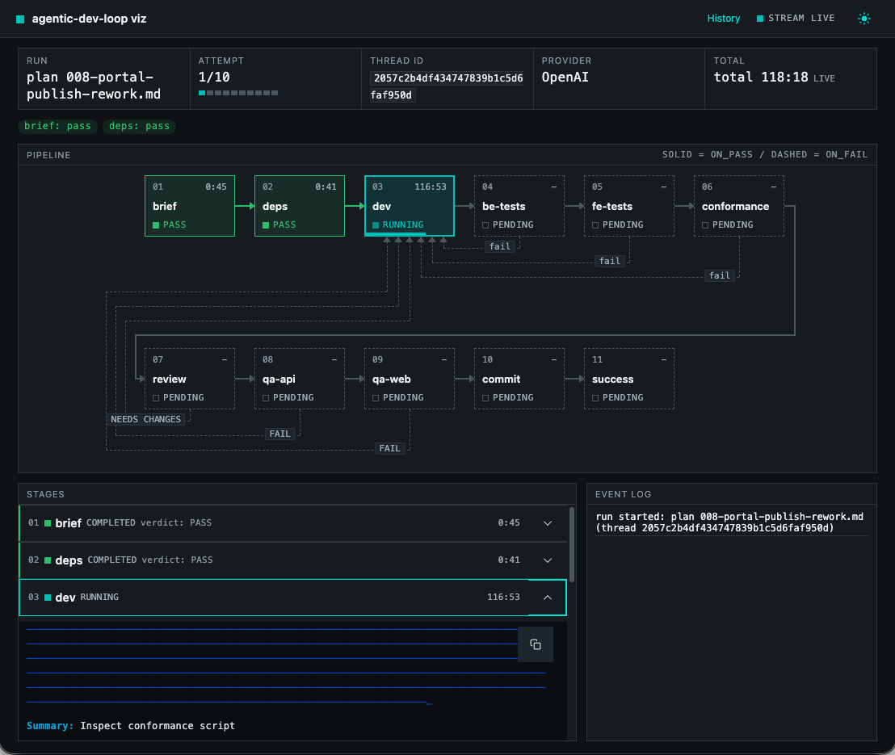

# agentic-dev-loop

> **Turn an LLM into a gated, sandboxed, resumable construction loop over your codebase.**

Describe your pipeline in one YAML file - agent steps, mechanical test gates, and
trusted actions - and `agentic-dev-loop` runs it end to end: agent and command steps get
kernel-level sandboxing via Docker, verdicts route the graph, every boundary is
checkpointed, and nothing gets committed until every gate passes.



## Key features

- **A tool, not a wiring project.** One CLI entry point, opinionated defaults,
  fixed safety policies. You write the pipeline and the agent definitions -
  nothing else.
- **Deterministic.** Same pipeline + same state means the same routing.
  Verdicts are parsed from files and validated tool calls, retries are
  bounded, nothing is best-effort.
- **Sandboxed by default.** The agent's shell and every command step run
  inside an always-on Docker sandbox: network off by default, writes only to
  declared `mounts:`, no `.git`. If no sandbox is available, the run stops
  instead of degrading.
- **Crash-safe and resumable.** Every boundary is checkpointed; interrupt a
  run and resume it from the exact checkpoint with `--resume`, notes intact.
- **Watchable.** A live browser graph view with per-stage consoles and an
  event log, a browsable run history, and markdown reports.
- **Gated commits.** A single commit point that fires only when every gate
  passed and the worktree was clean at start.
- **Supply-chain careful.** A digest-pinned dev image, a locked-by-default
  dependency policy, and a CVE-audited restore step.
- **Secret-safe.** Secrets are refs in config, values in the host environment,
  opted in per step, and scrubbed from every engine-written output; the
  workspace may not contain `.env*` files.
- **Onboarding that stays honest.** `init` scaffolds a working loop for your
  repo, `doctor` probes the host before every run, `upgrade` converges the
  install and the pinned version.
- **Extensible.** Plugins add your own actions, tools, and document loaders,
  loaded from outside the workspace only.

## Supported platforms

The engine is plain Linux under the hood and runs wherever a compliant
Docker engine does:

| Platform | Support |
| --- | --- |
| **Linux** | Native. Docker Engine, OrbStack, Colima, or podman with docker compat. |
| **macOS** | Native. Docker Desktop, OrbStack, or Colima. |
| **Windows** | Via **WSL2** (Ubuntu distro). Enable Docker Desktop's WSL integration (or run Docker Engine inside the distro) and keep the repo on the WSL filesystem (`~/dev/...`), not `/mnt/c` - bind-mounting a 9p path into containers breaks permissions and is slow. |

## Quickstart

### Prerequisites

| Requirement | Detail |
| --- | --- |
| Python | >= 3.12 |
| Docker engine | Engine API >= 1.43 (Engine 24). Any compliant engine works - Docker Desktop, OrbStack, Colima, Rancher Desktop, podman docker-compat. On Windows, run under WSL2: the repo must live on the WSL filesystem, not /mnt/c. |
| LLM API key | The env var named by your pipeline's `api_key_env` (e.g. `OPENAI_API_KEY`) must be set - a missing key fails fast, naming it. Alternatively, `agentic-dev-loop copilot-login` authenticates a Copilot subscription, and a Claude Pro or Max subscription runs on Anthropic's own endpoint after `claude login` (see [LLM providers](https://lukedawilson.github.io/agentic-dev-loop/llm-providers/)). |

### Installation

```bash
pipx install --pip-args="--pre" agentic-dev-loop   # latest release is currently a pre-release
agentic-dev-loop --version
```

Install with **pipx**: the engine's venv lives outside the workspace, so it
is unmounted from the sandbox and never agent-writable. On the first run the
engine pulls the digest-pinned dev image and verifies its digest. Setup
details and troubleshooting live in the [setup guide](https://lukedawilson.github.io/agentic-dev-loop/setup/).

### Your first loop

```bash
cd <your-repo>
agentic-dev-loop init --profile python                     # writes the pipeline + agents
export OPENAI_API_KEY=...                                  # whatever api_key_env names
agentic-dev-loop agentic-dev-loop/pipeline.yaml --dry-run  # validate - no LLM, no Docker
agentic-dev-loop agentic-dev-loop/pipeline.yaml            # run it
```

`init` scaffolds `agentic-dev-loop/pipeline.yaml` plus the agent files it
names; `--dry-run` loads and validates with no LLM, no Docker, and no state
writes. A minimal pipeline looks like:

```yaml
name: my-construction-loop

llm:
  model: openai/deepseek-v4-pro
  base_url: https://api.deepseek.com
  api_key_env: OPENAI_API_KEY

max_attempts: 10
agents_dir: sdk_agents

steps:
  - name: dev
    agent: dev
    produces: implementation-summary.md
    on_pass: test

  - name: test
    command: .venv-sandbox/bin/python -m pytest tests/ -q
    on_pass: review
    on_fail: { goto: dev, retry: true }

  - name: review
    agent: review
    artifact: review-findings.md
    verdicts: { pass: APPROVED, fail: NEEDS CHANGES }
    on_pass: commit
    on_fail: { goto: dev, retry: true }

  - name: commit
    action: commit
    params: { message: "feat: construct {subject}" }
```

Every field - per-step isolation, mounts and egress, secrets, dependency
policy, named LLM profiles - is in the
[pipeline.yaml reference](https://lukedawilson.github.io/agentic-dev-loop/pipeline/).

## Documentation

| Page | What it covers |
| --- | --- |
| [Architecture](https://lukedawilson.github.io/agentic-dev-loop/architecture/) | The five layers, one full run end to end, and the host-boundary security model |
| [CLI](https://lukedawilson.github.io/agentic-dev-loop/cli/) | Run flags, resuming, the live view, reports, container management, and onboarding commands |
| [pipeline.yaml](https://lukedawilson.github.io/agentic-dev-loop/pipeline/) | The complete configuration reference: steps, isolation, secrets, networking, dependency policy |
| [LLM providers](https://lukedawilson.github.io/agentic-dev-loop/llm-providers/) | OpenAI-compatible endpoints (OpenAI, DeepSeek, and others), the GitHub Copilot subscription, and the Claude subscription |
| [Authoring a loop](https://lukedawilson.github.io/agentic-dev-loop/authoring/) | From `init` to a committed pipeline: agent files, stage lineup, adaptation checklist |
| [Setup and troubleshooting](https://lukedawilson.github.io/agentic-dev-loop/setup/) | Docker engines, the dev image, caching, error codes |
| [Browser sandbox](https://lukedawilson.github.io/agentic-dev-loop/browser-sandbox/) | Running a browser inside the sandbox |
| [Known issues](https://lukedawilson.github.io/agentic-dev-loop/known-issues/) | Container lifecycle edge cases |

## Contributing

Read [AGENTS.md](https://github.com/lukedawilson/agentic-dev-loop/blob/main/AGENTS.md) first -
it is the instruction set for both human and agent contributors - then see
[CONTRIBUTING.md](https://github.com/lukedawilson/agentic-dev-loop/blob/main/CONTRIBUTING.md)
for the development workflow and the OpenCode commands.

---

Built on [OpenHands SDK](https://github.com/OpenHands/software-agent-sdk) and
[LangGraph](https://github.com/langchain-ai/langgraph).
