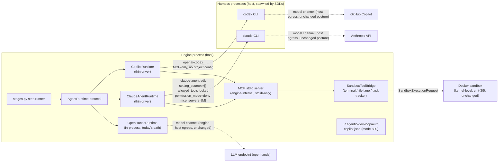

# Unit 10 Deployment Architecture - multi-provider runtime

Stage: Infrastructure Design. Component-level view of how the three providers plug into the engine, and what changes for deployment.

## Component view (proposed target state)

Note: `finish` is harness-native (not MCP-exposed); the MCP surface is exactly `terminal`, `file_editor`, `task_tracker`. OpenHands does NOT use the MCP/bridge path: it keeps the in-process SDK tools and shares only the catalog naming contract, the policy-resolution helpers, and the Sandbox.run gate.

## Deployment changes

- Package: `pip install agentic-dev-loop` unchanged (openhands, zero new required deps). New: `pip install agentic-dev-loop[claude]` / `[copilot]` for the drivers.
- Config: a `provider: claude` / `provider: copilot` top-level key plus the matching provider block; existing pipelines untouched (rule zero).
- User setup per provider:
  - claude subscription: the user runs `claude login` once (Anthropic's own flow); the engine detects the credential store and fails fast with guidance otherwise. Key mode: `ANTHROPIC_API_KEY` exported in the engine's environment.
  - copilot: first run (or expired token) triggers the engine-hosted GitHub device flow (prints code + URL; user completes in browser); the token persists at `~/.agentic-dev-loop/auth/copilot.json`.
- Machine requirements: the harness CLIs must be installed per their SDKs' requirements on the same host as the engine (macOS/Linux/Windows all supported); the Docker sandbox requirements are unchanged from unit-3.
- CI: base job extras-free; compat/contract job installs both extras (ubuntu + windows); live smoke is manual at the dogfood gate (`RUN_LIVE_HARNESS=1`).

## Trust and isolation summary

- The agent brain (harness) runs on the host and never receives sandbox credentials, pipeline secrets, or a shell on the workspace; its only executable channel is the bridge, and the bridge only executes through `Sandbox.run`.
- Everything the agent executes remains under the kernel-level sandbox, the egress policy, the forbidden-command rules, the mounts, and the allowlist - identical to today for every provider.
- The MCP server binds no network sockets and holds no engine state; only tool I/O crosses the stdio channel.
