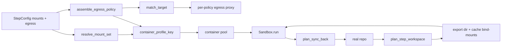

# Business Logic Model - unit-5 (workspace egress isolation)

> FD-stage (2026-10-25). Resolves intent open questions Q1-Q9 plus follow-ups F1/F2, and carries the multi-toolchain requirement (user reminder 2026-10-25): the egress presets and cache declarations must serve pypi, npm, .NET (NuGet), and Rust toolchains with no per-toolchain mechanism.

## Core Flow

Unit 5 replaces "every container mounts {workspace} rw, `network: true` = unrestricted" with per-step mount sets and per-step egress policies. The flow splits into two runtime contexts:

**Load time (once, pipeline build):**

1. Config load validates the per-step `mounts` and `egress` declarations (unknown keys → loud error). **Strict-by-default (Q4):** empty or missing `mounts` = empty mount set - the step mounts nothing until declared.
2. **Policy assembly (Q1/Q2, amended 2026-10-25):** for each distinct egress policy: expand presets (Q9), validate targets (entries stay domain-shaped), and generate a per-policy proxy config. The engine runs a local per-policy egress proxy and forces container HTTP(S) traffic through it (`HTTP_PROXY`/`HTTPS_PROXY` env + no direct route); the proxy matches the request hostname (CONNECT target) per connection. No IP resolution, no nftables, no in-container NET_ADMIN (`--cap-drop ALL` unchanged). The proxy is the enforcement point on all platforms.
3. **Export materialisation (Q5/F2):** the engine materialises a fresh repo export (git worktree-add or archive) into a run temp dir; `.git` is absent by construction. Declared cache paths (in-workspace, rw) are bind-mounted into the export at the same relative paths; a missing cache path at export time is a loud failure.
4. **Container pool (D-1):** containers are created lazily per distinct ContainerProfile (mount set + egress policy + seccomp/cap policy) and destroyed at pipeline end + error paths. The provision container keeps its broad-egress trust-phase profile (stamp-cached setup, unchanged from unit-3 BR-13).

**Run time (per sandboxed step):**

5. `resolve_mount_set(step)` → MountSet; `assemble_egress_policy(step)` → EgressPolicy; `container_profile_key(...)` → the pool key. A step with no profile match creates its container (failures loud).
6. `Sandbox.run(request)` in the profile's container: the request cwd is inside the export; reads/writes land in the export or the bind-mounted caches. Read-only mounts are enforced at the Docker layer (`ro` submounts).
7. **Sync-back (F1):** after a step that declared rw paths, the engine syncs the export's changes back to the real repo, git-aware, with the sandbox detached; conflicts are loud.
8. Network-on steps: traffic beyond the allowlist is denied at the proxy (hostname matching). Browser-class steps (Q8) run under the explicit broad-but-logged policy with connection logging; command/agent steps keep strict allowlists.
9. Audit: every sandboxed execution, every browser-step connection log entry, and every sync-back is recorded host-side (structured, no secrets).

## Key Decisions (from FD Q&A)

| Decision | Rule |
| --- | --- |
| Q1 | Egress enforcement = engine-managed per-policy egress proxy, the enforcement point on all platforms (amended 2026-10-25: nftables dropped). No in-container NET_ADMIN. |
| Q2 | Domain entries resolved to IP sets at policy-assembly time; re-resolution on network/container rebuild. Handles registry/CDN drift. |
| Q3 | Declared-writes model: every mount entry carries a mode; source/docs default ro; only declared outputs and caches are rw per step. |
| Q4 | Strict-by-default: empty or missing `mounts` = empty mount set (mount nothing). Dogfood pipeline + the reference consumer repo gain explicit declarations as part of this unit. |
| Q5 | Worktree-export: engine materialises a fresh repo export into a temp dir and mounts that; `.git` absent by construction. |
| Q6 | Caches stay in-workspace at current paths, declared rw under the top-level `caches:` field (028). |
| Q7 | Tiered testability: pure functions everywhere; fake Sandbox backend for run-loop logic; docker-marked tests opt-in; proxy enforcement tests portable (no root), normal CI, never silently skipped. |
| Q8 | Browser steps get an explicit broad-but-logged egress class (connection logging); command/agent steps keep strict allowlists. |
| Q9 | Engine-shipped presets + pipeline-author override; undeclared targets fail loudly; the engine never adds targets. |
| F1 | Sync-back after each step with declared rw mounts (git-aware; sandbox detached during step). |
| F2 | Real-workspace `caches:` paths bind-mounted into the export at the same relative paths, rw; a missing declared cache is auto-created host-side (028). |
| D-1 | Profile-keyed container pool (mount set + egress policy + seccomp/caps), extending unit-3's persistent-per-run lifecycle rather than replacing it. |
| D-2 | Multi-toolchain egress is preset data and caches are pipeline declarations - never mechanism (amended 2026-10-25). |

## Multi-toolchain coverage (user requirement)

One **package-registries** preset serves every toolchain; restore steps reference it, so plan 018's toolchain-agnostic restore stays agnostic - no toolchain-specific egress config:

| Toolchain | Targets |
| --- | --- |
| Python (pip) | `pypi.org`, `files.pythonhosted.org`; `api.osv.dev` (pip-audit) |
| Node (npm) | `registry.npmjs.org`; `nodejs.org` (node-gyp headers) |
| .NET (NuGet) | `api.nuget.org` |
| Rust (cargo) | `crates.io`, `static.crates.io` |
| VCS / source installs | `github.com`, `codeload.github.com`, `objects.githubusercontent.com` |

**Per-toolchain cache declarations** (all in-workspace, rw, bind-mounted into the export; author-declared under `caches:` in `pipeline.yaml` - the engine ships no cache dirs):

| Toolchain | Cache paths |
| --- | --- |
| Python | `.venv-sandbox` (plan 022 sandbox venv) |
| Node | `node_modules`, `qa/node_modules`, `qa/.browsers` (chromium binary + syslibs) |
| .NET | `.nuget-packages` |
| Rust | `target/` (build outputs - declared rw by the build step) |

Adding a toolchain = egress preset data + a `caches:` entry in `pipeline.yaml`; no mechanism change.

## Algorithms

**Mount-set resolution** (`resolve_mount_set(step_mounts)`): strict default (Q4); validate each path (repo-relative, no traversal, never `.git` or host-only dirs, no `state_dir`); mode per entry; ro for everything not declared rw (Q3). Pure function.

**Egress assembly** (`assemble_egress_policy(step_egress)`): expand preset references (Q9); validate targets (scheme/host/port shape); classify the policy class (strict allowlist | broad-but-logged browser class, Q8); reject unknown preset names loudly. Pure function.

**Target matching** (`match_target(hostname, policy)`): allowlist entries stay domain-shaped; the proxy matches the request hostname (CONNECT target) per connection against the expanded policy; unmatched = deny + logged as an enforcement event (Q2 amended, BR-6). Pure.

**Export planning** (`plan_step_workspace(repo, cache_paths, platform, excludes)`): export dir layout, cache bind-mount list, existence checks (missing cache path = loud race guard; startup pre-creates, 028), and scratch excludes skipped at copy time. Pure over platform facts.

**Sync-back planning** (`plan_sync_back(export_changes, declared_rw, cache_paths, excludes)`): which changed paths sync (only declared-rw paths, minus caches and sync-excludes); git-aware (never touches `.git`); conflict detection. Pure function.

**Profile keying** (`container_profile_key(mount_set, policy)`): stable pool key; equal profiles ⇒ same container (D-1). Pure function.

## Data Flow

## PBT targets (PBT-03)

- Serialisation round-trips: `MountSpec`/`MountSet`, `TargetEntry`/`EgressPolicy` (config → model → config).
- `container_profile_key` stability: same (mount set, policy) ⇒ same key, every time.
- `resolve_mount_set` idempotence + strict-default property: empty input ⇒ empty mount set.
- `assemble_egress_policy` preset expansion determinism + unknown-preset rejection.
- `plan_step_workspace` path invariants: export paths stay inside the export root; no `.git` in any produced path.
