# Step Execution Flow (unit-5, with egress)

Per-step execution flow including the unit-5 proposal: per-step mount
resolution, egress policy assembly, the profile-keyed container pool, the
engine-run egress proxy, the StepWorkspace, and sync-back. Drawn from the
unit-5 functional design (business-logic-model.md) and infrastructure design
(infrastructure-design.md, deployment-architecture.md).

## Diagram

```mermaid
flowchart TD
    subgraph LOAD["Load time - once per pipeline run"]
        direction TB
        L1["Validate pipeline.yaml: strict-by-default mounts, egress declarations, secret refs"] --> L2["Expand egress presets: registries for pip, npm, nuget, crates"]
        L2 --> L3["Materialise StepWorkspace: copy repo minus .git to state_dir/exports/run-id"]
        L3 --> L4["Bind declared caches rw at same relative paths - existence checked, loud if missing"]
    end
    subgraph STEP["Each step - run time"]
        direction TB
        S1["resolve_mount_set(step): declared paths or empty set (mount nothing)"] --> S2["assemble_egress_policy(step): preset expansion + class (allowlist or broad-but-logged)"]
        S2 --> S3["container_profile_key(mount set, egress policy, seccomp caps)"]
        S3 --> S4{"Profile container already in pool?"}
        S4 -->|yes| S6["Route the exec to the pooled container"]
        S4 -->|no| S5["Create hardened container: cap-drop ALL, read-only rootfs, seccomp, tmpfs, host uid:gid"]
        S5 --> S5a{"Step network enabled?"}
        S5a -->|yes| S5b["Start per-policy egress proxy on an ephemeral loopback port - idempotent retry"]
        S5b --> S5c["Inject HTTP_PROXY / HTTPS_PROXY / NO_PROXY + host-gateway add-host"]
        S5c --> S6
        S5a -->|no| S6
        S6 --> S7{"Step kind"}
        S7 -->|command| S8["Sandbox.run(request) with cwd inside the StepWorkspace"]
        S7 -->|agent| S9["Agent step runs - terminal tool delegates each call to Sandbox.run"]
        S7 -->|action| S10["Host-side action: no container, no egress"]
        S8 --> S11["Outbound attempt from the container"]
        S9 --> S11
        S11 --> S12{"Egress proxy: match_target(hostname)"}
        S12 -->|allowed| S13["Forward connection - browser class logs every connection (broad-but-logged)"]
        S12 -->|denied| S14["Deny + log an enforcement event"]
        S14 --> S15["Step fails loud - never silently degraded"]
        S13 --> S16["Capture output, parse verdict - unit-1/2 loop mechanics"]
        S15 --> S16
        S16 --> S17{"Declared rw mounts exist?"}
        S17 -->|yes| S18["sync_back: git-aware diff-copy of declared-rw paths, conflicts loud"]
        S17 -->|no| S19["Route by verdict"]
        S18 --> S19
        S19 -->|"retry or next step"| S1
    end
    LOAD --> STEP
    STEP --> ENDING["Run end or error path: destroy containers, kill proxies, remove StepWorkspace, rotate egress logs"]
    ENDING --> DONE["Pipeline complete"]
```

## Walkthrough

- **Load time** (once per run): config validation fails loud on malformed
  mount or egress entries. Presets (multi-toolchain registries, BR-9) expand
  into target sets. The StepWorkspace materialises: a .git-free copy of the
  repo under `state_dir/exports/<run-id>/`, with declared caches
  (`.venv-sandbox`, `node_modules`, `qa/.browsers`, `.nuget-packages`,
  `target/`) bind-mounted rw at the same relative paths. The real workspace
  is never mounted into any sandbox container.
- **Per step**: the mount set resolves (strict-by-default: undeclared steps
  mount nothing), the egress policy assembles, and the pair plus the
  seccomp/cap set keys the profile pool (D-1). Reused profile = reused
  container; a new profile creates a hardened container and, for
  network-enabled steps, starts its per-policy egress proxy and points the
  container at it (proxy env vars + `host.docker.internal` host-gateway,
  ID-2).
- **Inside the step**: command steps run through `Sandbox.run` with cwd in
  the StepWorkspace; agent steps run the agent, whose terminal tool
  delegates each call to the same sandbox; action steps stay host-side.
  Every outbound attempt transits the proxy, which matches the request
  hostname per connection (BR-6): allowed targets forward, unmatched
  targets are denied and logged as enforcement events. Browser-class
  policies forward everything but log every connection (BR-7).
- **After the step**: output capture and verdict parsing are the existing
  unit-1/2 loop mechanics. If the step declared rw mounts, sync-back copies
  the declared-rw changes back into the real repo (git-aware, conflicts
  loud, BR-4). Verdict routing loops back for retry or the next step.
- **Teardown**: on completion or any error path, containers are destroyed,
  proxies killed, the StepWorkspace removed, and egress logs rotated.
  Nothing survives the run.

## Failure modes (all loud)

- Proxy crash while a container depends on it = fail closed (loud, run
  fails); the proxy is never silently restarted around a live container.
- Missing declared cache path = loud preflight failure (BR-3).
- Malformed egress entry that can never match = loud load-time failure
  (BR-6).
- Sync-back conflict = loud, named path (BR-4).
- Enforcement denial = logged enforcement event + failed step, never a
  silent degrade (BR-5/BR-11).

## Not shown (kept out for readability)

- The provision phase (setup hooks, stamp-cached) runs in a broad-egress
  trust-phase container before any agent input exists; it is not part of
  the per-step path.
- The deps_policy locked/open dial (plan 021) and secret resolution
  (plan 019) happen in load-time validation and step env assembly
  respectively, feeding the nodes shown here.
