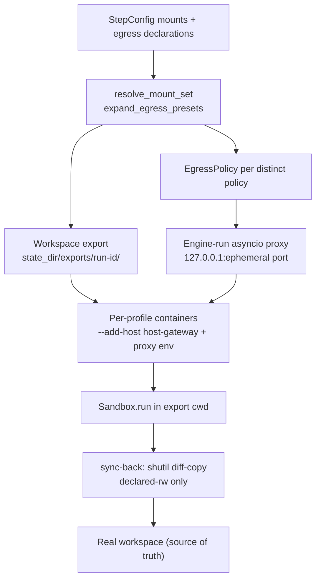

# Unit 5 Infrastructure Design - workspace egress isolation

## Positioning

Close the last structural exfil channel: per-step mount granularity (rw/ro/absent + `.git` blindness) and egress allowlists. After the 2026-10-25 enforcement-point amendment the egress proxy is THE enforcement point on all platforms; kernel-level enforcement is deferred to unit-7 (native Linux backend, unit-3 FD-2 answer B scope).

## Topology

## Key structures

| Concern | Design |
| --- | --- |
| Proxy implementation (ID-1) | Hand-rolled minimal asyncio forward proxy module in the engine. Stdlib only (no new dependencies; plan 021 policy untouched). Handles CONNECT tunneling + absolute-URI requests, hostname allowlist matching (BR-6.1), deny + connection logging (BR-6.2). Unit-testable without Docker. |
| Container reachability (ID-2) | `--add-host=host.docker.internal:host-gateway` on every container (Docker 20.10+; identical on Docker Desktop macOS/Windows and Linux Docker). Proxy env injected: HTTP_PROXY/HTTPS_PROXY/NO_PROXY pointing at the engine-run proxy. |
| Proxy lifecycle (ID-3) | Ephemeral loopback port per policy per run (`127.0.0.1:0`). Engine spawns and owns the proxy process; killed at pipeline end and on error paths. Idempotent startup with bounded retry (NFR-5.4). No port collisions, no long-lived daemons. |
| Export materialisation (ID-4) | Copy-based: copytree-style copy of the workspace into `state_dir/exports/<run-id>/` excluding `.git` and host-only dirs. Dirty working tree preserved exactly; `.git` absent by construction (BR-2). Declared cache paths bind-mounted rw into the export at the same relative paths (F2), existence-checked loudly at export time (BR-3). |
| Sync-back (ID-5) | In-process shutil-based diff-copy: walk the export, copy changed files back, apply deletions where declared-rw. Git-aware, never touches the real `.git`. Conflicts loud, named (BR-4). No rsync binary dependency (Windows). |
| CI wiring (ID-6) | Enforcement tests spin up local 127.0.0.1 test servers and assert proxy allow (listed hostname) / deny + log (unlisted). Runs in the existing ubuntu+windows matrix jobs; no root, no privileged job, never silently skipped. Real-Docker tests stay marked/opt-in. |

## Failure modes (fail fast / fail loud)

| Failure | Behaviour |
| --- | --- |
| Proxy port bind failure | Loud, bounded retry, run fails |
| Proxy process crash mid-run | Loud; requests fail closed (proxy down = no egress) |
| Unmatched egress hostname | Deny + logged enforcement event (BR-6.2) |
| Malformed allowlist entry | Loud load-time failure (BR-6.3) |
| Export copy failure (disk/permissions) | Loud, names the path |
| Cache path missing at export time | Loud existence check before containers start (BR-3) |
| Sync-back conflict or rename surprise | Loud report naming files (BR-4) |
| Export/sync-back partial state on error | Containers destroyed; export dir cleaned at run end and error paths (BR-10/BR-11) |

## Category applicability (mandatory evaluation)

| Category | Disposition | Justification |
| --- | --- | --- |
| Deployment Environment | Applicable | Docker Desktop (macOS/Windows) + Linux Docker hosts; proxy runs engine-side on all three; host-gateway mapping works on Docker 20.10+ everywhere (ID-2) |
| Compute | Applicable (scoped) | Export copy + sync-back + proxy run on the host; bounded by NFR-5.1 practical targets (seconds for typical repos), measured not enforced |
| Storage | Applicable | `state_dir/exports/<run-id>/` transient per run; egress logs with bounded rotation (NFR-5.5) |
| Messaging | N/A | No queues/brokers; step traffic is the existing in-process model |
| Networking | Applicable (local + egress) | Proxy is the sole egress path for network-on containers (ID-1..3); loopback-bound, engine-owned |
| Monitoring | N/A | state_dir structured logs (NFR-5.5); no external monitoring |
| Shared Infrastructure | N/A | Single-tenant local tooling; no shared infra to design (unit-4 precedent) |
