# Domain Model ERD (entire app)

Cross-unit reference for the agentic-dev-loop domain model, drawn from the
unit domain inventories: unit-1 (output-passing fix), unit-2 (SDK-level
hardening), unit-3 (always-on sandbox isolation), and the unit-5 proposal
(workspace egress isolation), plus the core config surface and the plan-019
secrets model / plan-021 deps policy.

Unit-5 entities are the **proposal** (Code Generation Part 1 pending
approval); everything else is shipped. External actors (Docker daemon,
registries/CDNs, app endpoints, host environment) are deliberately not
modelled.

The DDD classification is shown in each entity title as `(Type)` (entity
name aliases with quoted labels, mermaid 10.5+). Public methods appear as
`fn` rows with full signatures in the comments. A classification table and a
method table follow the diagram.

## Diagram

```mermaid
erDiagram
    PipelineConfig ||--o{ StepConfig : "declares steps"
    PipelineConfig ||--o| IsolationConfig : "isolation"
    PipelineConfig ||--o| DependencyPolicy : "deps_policy"
    PipelineConfig ||--o{ SecretRef : "secrets"
    SecretRef ||--o| SecretProvider : "resolved by"
    StepConfig }o--o{ SecretRef : "references"
    StepConfig ||--o{ MountSpec : "mounts"
    StepConfig ||--o| EgressPreset : "egress preset"
    StepConfig ||--o| EgressPolicy : "assembles to"
    StepConfig }o--o| Registry : "action and tool lookup"
    EgressPreset ||--o{ TargetEntry : "expands to"
    EgressPolicy ||--o{ TargetEntry : "contains"
    Step ||--|| StepConfig : "configured by"
    Runtime ||--o{ Step : "orchestrates"
    Step ||--o| CapturedOutput : "produces"
    CapturedOutput ||--o| Verdict : "parses"
    Step ||--o| Verdict : "routes on"
    Step ||--o| SandboxExecutionRequest : "sandboxed exec"
    IsolationConfig ||--o| EffectiveProfile : "effective profile"
    EffectiveProfile ||--o| ContainerProfile : "seccomp caps"
    Sandbox ||--o{ SandboxExecutionRequest : "run"
    Sandbox ||--o{ SandboxExecutionResult : "returns"
    DockerBackend ||--|| Sandbox : "implements"
    DockerBackend ||--o{ ContainerProfile : "profile pool"
    DockerBackend ||--o| EgressProxy : "runs"
    DockerBackend ||--o| StepWorkspace : "orchestrates"
    ContainerProfile ||--|| MountSet : "mount set"
    ContainerProfile ||--|| EgressPolicy : "egress policy"
    MountSet ||--o{ MountSpec : "contains"
    EgressProxy ||--|| EgressPolicy : "enforces"
    StepWorkspace ||--o| MountSet : "mount points"
    StepWorkspace ||--o{ SyncBackReport : "sync back"
    SandboxExecutionRequest ||--o| MountSet : "mounts"

    PipelineConfig["PipelineConfig (ValueObject)"] {
        string name
        list steps "StepConfig refs"
        string deps_policy
        list lockfiles
        dict secrets "SecretRef refs"
    }
    IsolationConfig["IsolationConfig (ValueObject)"] {
        string image
        bool refresh
        string memory
        float cpus
        bool allow_git_mutations
        Path state_dir
        Path sandbox_venv_dir
        Path seccomp_profile
    }
    StepConfig["StepConfig (ValueObject)"] {
        string name
        enum kind
        dict params
        list produces
        string artifact
        list verdicts
        int max_iterations
        int timeout
        dict env
        string setup
        bool network
        list mounts "MountSpec refs"
        EgressSpec egress
        list on_pass
        list on_fail
        list on_unverifiable
        fn kind "kind() -> str"
    }
    Verdict["Verdict (ValueObject)"] {
        enum kind
        fn from_text "from_text(text, verdicts) -> Result[Verdict]"
    }
    CapturedOutput["CapturedOutput (ValueObject)"] {
        string raw_text
        Path artifact_path
        Verdict verdict
        fn from_agent_result "from_agent_result(result, step, state_dir) -> Result"
        fn write "write() -> Result[None]"
    }
    SecretRef["SecretRef (ValueObject)"] {
        string name
        string key
        string provider
    }
    SecretProvider["SecretProvider (Adapter)"] {
        string kind
        fn resolve "resolve(keys) -> dict[str, str]"
    }
    DependencyPolicy["DependencyPolicy (ValueObject)"] {
        enum policy
        list lockfiles
    }
    EffectiveProfile["EffectiveProfile (ValueObject)"] {
        bool network_off
        bool read_only_rootfs
        bool writes_only_on_mounts
        bool drop_all_capabilities
        bool git_mutations_blocked
        string image
        string memory
        float cpus
    }
    SandboxExecutionRequest["SandboxExecutionRequest (ValueObject)"] {
        list argv
        Path cwd
        dict env
        int timeout
        MountSet mounts
        fn validate "validation at construction"
    }
    SandboxExecutionResult["SandboxExecutionResult (ValueObject)"] {
        int exit_code
        string stdout
        string stderr
        float duration
        string backend
        fn succeeded "succeeded() -> bool"
        fn is_timeout "is_timeout() -> bool"
    }
    MountSpec["MountSpec (ValueObject)"] {
        Path path
        enum mode
    }
    MountSet["MountSet (ValueObject)"] {
        list mounts "MountSpec refs"
        fn validate "repo-relative, no traversal, never .git"
    }
    TargetEntry["TargetEntry (ValueObject)"] {
        string host
        int port
        enum class
    }
    EgressPreset["EgressPreset (ValueObject)"] {
        string name
        list targets "TargetEntry refs"
    }
    EgressPolicy["EgressPolicy (ValueObject)"] {
        enum class
        list targets "TargetEntry refs"
        fn validate "preset expansion + target validation"
    }
    EgressProxy["EgressProxy (Infrastructure)"] {
        int loopback_port
        Path log_file
    }
    ContainerProfile["ContainerProfile (ValueObject)"] {
        MountSet mount_set
        EgressPolicy egress_policy
        string seccomp_caps
        string profile_key
        fn key "profile_key() -> stable pool key"
    }
    StepWorkspace["StepWorkspace (Entity)"] {
        Path export_root
        Path repo
        list cache_paths
        fn materialise "materialise(repo, cache_paths, platform) -> StepWorkspacePlan"
        fn mount_points "mount_points() -> docker mount list"
        fn sync_back "sync_back(declared_rw) -> SyncBackReport"
    }
    SyncBackReport["SyncBackReport (ValueObject)"] {
        list synced_paths
        list conflicts
        string step_id
        string timestamp
    }
    Step["Step (Entity)"] {
        string name
        StepConfig config
        int attempt
        dict step_verdicts
        list notes
        fn route "route(verdict) -> next step"
    }
    Runtime["Runtime (ApplicationService)"] {
        PipelineConfig cfg
        Registry registry
        LLM llm
        Path agents_dir
        Path state_dir
        Path workspace
        Sandbox sandbox
        dict secrets
        fn run_agent "run_agent(agent_name, message, runtime, max_iterations, step) -> AgentResult"
    }
    Sandbox["Sandbox (Interface)"] {
        fn run "run(request) -> SandboxExecutionResult"
        fn close "close() -> destroy"
    }
    DockerBackend["DockerBackend (Entity)"] {
        string image
        string workspace
        Path iso_state_dir
        EffectiveProfile profile
        string run_id
        string container
        string network_container
        bool network_enabled
        Path sandbox_venv_dir
        Path seccomp_profile
        fn ensure_image "ensure_image()"
        fn create_execution_container "create_execution_container()"
        fn provision "provision(setup_cmd, stamp_key, stamp_dir, ...)"
        fn run "run(request) -> SandboxExecutionResult"
        fn close "close() -> idempotent destroy"
    }
    Registry["Registry (Entity)"] {
        dict actions
        dict sandbox_actions
        list document_loaders
        dict cli_option_owners
        bool host_actions_open
        Path workspace
        fn add_action "add_action(name, fn)"
        fn add_sandbox_action "add_sandbox_action(name, script)"
        fn seal_host_actions "seal_host_actions()"
        fn add_document_loader "add_document_loader(loader)"
        fn add_tool "add_tool(name, tool)"
    }
```

## DDD classification

| Type | Entities | Basis |
| --- | --- | --- |
| ValueObject | PipelineConfig, StepConfig, IsolationConfig, EffectiveProfile, DependencyPolicy, SecretRef, Verdict, CapturedOutput, SandboxExecutionRequest, SandboxExecutionResult, MountSpec, MountSet, TargetEntry, EgressPreset, EgressPolicy, ContainerProfile, SyncBackReport | descent step 1 (VO with invariant behaviour); config models carry load-time validation |
| Entity | Step, Registry, DockerBackend, StepWorkspace | descent step 3 (own lifecycle / identity); Step is conceptual (StepConfig + LoopState, no class); StepWorkspace = engine-owned lifecycle state |
| ApplicationService | Runtime | stages.py dataclass - the run's collaborators plus orchestration; unit-1 docs called it "StagesRuntime" (phantom name, corrected) |
| Interface | Sandbox | abstract seam (ABC, run/close only, genuinely no state); retained per unit-3 user directive |
| Adapter | SecretProvider (Protocol; EnvProvider = shipped impl) | infrastructure seam to the host environment |
| Infrastructure | EgressProxy | engine-run asyncio process (loopback, per-policy); outside the domain core |

Note: the AI-DLC unit docs loosely call the pydantic config models
(PipelineConfig / StepConfig / IsolationConfig) "entities"; they are
classified ValueObject here because they are compared by content and carry
no lifecycle of their own.

## Public methods (full signatures)

| Entity | Method | Signature / behaviour | Source |
| --- | --- | --- | --- |
| CapturedOutput | from_agent_result | `(result, step, state_dir) -> Result[CapturedOutput]` | outputs.py:35, unit-1 BR-3 |
| CapturedOutput | write | `() -> Result[None, CaptureError]` (hygiene + truncation rules) | outputs.py:45, unit-1 BR-4/5 |
| Verdict | from_text | `(text, verdicts) -> Result[Verdict, VerdictError]` (pure; NO_VERDICT / AMBIGUOUS) | verdict.py:49 |
| Step | route | `(verdict) -> next step` (NO_VERDICT/AMBIGUOUS map to retry edge) | conceptual (StepConfig + LoopState); realised in stages.py router/resolve |
| Runtime | run_agent | `(agent_name, message, runtime, max_iterations, step) -> AgentResult` - SDK run, capture, write, parse verdict | stages.py:96 (module-level function over the Runtime dataclass) |
| Registry | add_action | `(name, fn)` - host-side action registration | registry.py:131 |
| Registry | add_sandbox_action | `(name, script)` - sandboxed script registration | registry.py:147 |
| Registry | seal_host_actions | `()` - freeze host-side actions after load (plan 020) | registry.py:163 |
| Registry | add_document_loader | `(loader)` | registry.py:168 |
| Registry | add_tool | `(name, tool)` - collision-checked tool registration | registry.py:181, unit-2 BR-3 |
| SecretProvider | resolve | `(keys) -> dict[str, str]` - host env lookup, loud on missing | secrets.py:33 |
| Sandbox (surface) | run | `(request) -> SandboxExecutionResult` | isolation.py:599 |
| Sandbox (surface) | close | `()` - guaranteed destroy on every path | isolation.py:602 |
| DockerBackend | ensure_image | `()` - image presence, pull if absent (BR-8) | isolation.py:653 |
| DockerBackend | create_execution_container | `()` - eager container create at construction | isolation.py:679 |
| DockerBackend | provision | `(setup_cmd, stamp_key, stamp_dir, ...)` - stamp-cached setup hooks | isolation.py:713 |
| DockerBackend | run | `(request) -> SandboxExecutionResult` - exec inside container | isolation.py:750 |
| DockerBackend | close | `()` - idempotent destroy | isolation.py:781 |
| SandboxExecutionRequest | (constructor) | validates argv non-empty, cwd inside a mount, bounded sizes | isolation.py:110, BR-9 |
| SandboxExecutionResult | succeeded | `() -> bool` | isolation.py:134 |
| SandboxExecutionResult | is_timeout | `() -> bool` | isolation.py:138 |
| StepConfig | kind | `() -> str` (agent / action / command) | config.py:142 |
| MountSet | (constructor) | repo-relative only, no traversal, never .git / host-only / state_dir; empty = mount nothing | unit-5 BR-1 |
| EgressPolicy | (constructor) | preset expansion + target validation at assembly (BR-8) | unit-5 |
| ContainerProfile | profile_key | `() -> str` - stable pool key (D-1) | unit-5 |
| StepWorkspace | materialise | `(repo, cache_paths, platform) -> StepWorkspacePlan` - copy-based, .git absent | unit-5 BR-2/3 |
| StepWorkspace | mount_points | `()` - export root + cache bind-mounts at same relative paths | unit-5 BR-3 |
| StepWorkspace | sync_back | `(declared_rw) -> SyncBackReport` - git-aware, conflicts loud | unit-5 BR-4 |

Module-level pure functions (not entity methods, the PBT targets): unit-2
`proc.needs_shell / split_command / is_pid_token / child_env`; unit-3
`resolve_effective_profile / select_backend / resolve_sandbox_env /
docker_create_payload / setup_stamp_key / translate_mount_path /
is_git_mutation`; unit-5 proposal `resolve_mount_set / assemble_egress_policy /
match_target / plan_step_workspace / plan_sync_back / container_profile_key`.

EgressProxy's public surface is defined at implementation (code-gen steps
7-8): an engine-run asyncio forward proxy bound to an ephemeral loopback
port, with start/stop owned by DockerBackend (ID-3).

## Entity sources

| Entity | Source unit / plan | Status |
| --- | --- | --- |
| PipelineConfig, StepConfig, IsolationConfig | core config (src/agentic_dev_loop/core/config.py) | shipped |
| Step (conceptual: StepConfig + LoopState), Runtime, Verdict, CapturedOutput | unit-1 | shipped |
| Registry | unit-2 | shipped |
| SecretRef, SecretProvider | plan 019 | shipped |
| DependencyPolicy | plan 021 | shipped |
| Sandbox, DockerBackend, SandboxExecutionRequest, SandboxExecutionResult, EffectiveProfile | unit-3 | shipped |
| MountSpec, MountSet, TargetEntry, EgressPreset, EgressPolicy, ContainerProfile, StepWorkspace, SyncBackReport, EgressProxy | unit-5 proposal | pending (Code Generation Part 1) |

## Reading notes

- **Strict-by-default**: `MountSet` with an empty `mounts` list is a valid
  value (mount nothing). `StepConfig.mounts` empty means the step sees no
  workspace paths until the pipeline author declares them.
- **EgressPreset vs EgressPolicy**: presets are engine data (multi-toolchain
  registries, BR-9); the policy is the per-step resolved result assembled at
  load time. The proxy enforces hostname matching per connection (BR-6).
- **ContainerProfile** is the pool key (D-1): equal mount set + egress policy
  + seccomp/cap set share one container. It joins unit-3's isolation surface
  with unit-5's mount/egress resolution.
- **StepWorkspace** is the workspace as a step sees it. The real repo is
  never mounted: the engine materialises a .git-free copy of the workspace
  under `state_dir/exports/<run-id>/` (dirty files preserved), bind-mounts
  the declared caches read-write at the same relative paths, and mounts
  that export (plus cache mounts) into the step's container. Declared-rw
  changes are synced back to the real repo, git-aware, conflicts loud.
  Destroyed at run end. It exists because per-step mount scopes (unit-5)
  mean no step mounts "the workspace" any more, only its slice of a
  step-specific derivative of it.
- **Sandbox** is an abstract seam with zero state by design (ABC: run and
  close only). DockerBackend is the single implementation. The ERD labels it
  Interface, not Entity.
- **Runtime** (ApplicationService) is the code's real name for what unit-1
  docs called StagesRuntime: a dataclass of the run's collaborators, with
  module-level orchestration functions around it.
- **Step** has no class in the code: a runtime step is StepConfig (the
  declaration) plus LoopState (attempt, notes, step_verdicts, outcome).
  The ERD keeps it as a conceptual entity for readability.
- **EffectiveProfile** is the code's real name for the resolved isolation
  profile (the ERD previously used the phantom name IsolationProfile).

## Design questions resolved during ERD review (2026-10-25)

1. **run_agent placement** - RESOLVED: move onto `Runtime` as a method
   (the application service owns its operation). Folded into unit-5 code
   generation as step 15 / KD-8; a real code change pending the code-mode
   switch and the Part 1 approval.
2. **StepWorkspace naming** - RESOLVED: renamed from `WorkspaceExport` to
   `StepWorkspace` across all unit-5 docs (the step-visible derivative of
   the workspace, engine-owned, sync-back to the real repo).
3. **Step modelling** - RESOLVED: keep the conceptual Step node
   (StepConfig + LoopState + routing functions; noted in the doc).
