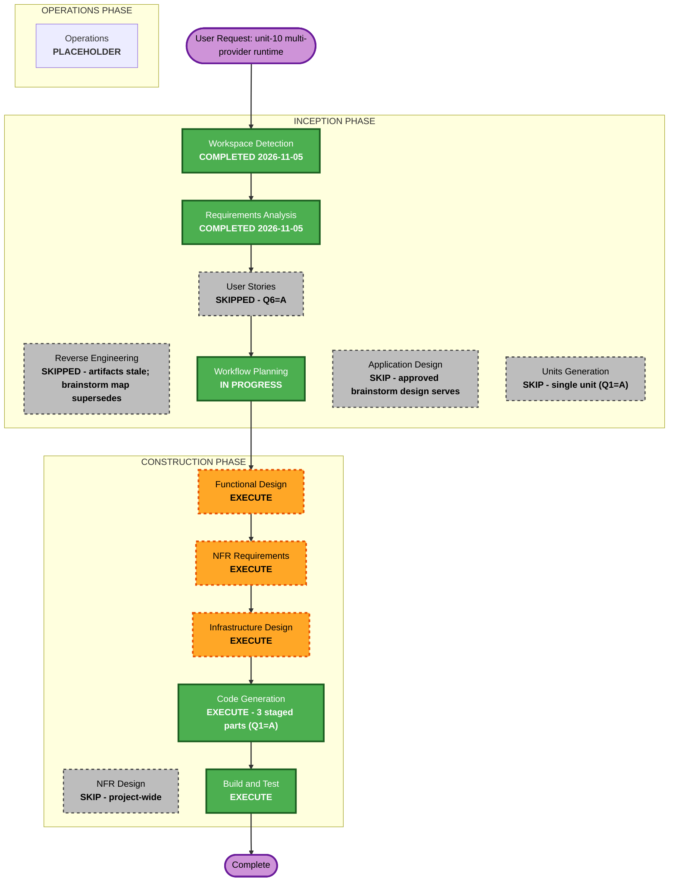

# Execution Plan - Unit 10 (Multi-provider Runtime)

## Detailed Analysis Summary

### Transformation Scope (Brownfield)

- **Transformation Type**: Architectural refactor + additive capability (new provider drivers)
- **Primary Changes**: `src/agentic_dev_loop/core/config.py` (provider key + ClaudeAgentConfig + CopilotConfig); `src/agentic_dev_loop/engine/stages.py` (step runner consumes AgentRuntime protocol only); `src/agentic_dev_loop/engine/outputs.py` (CapturedOutput.from_runtime_result); NEW package `src/agentic_dev_loop/engine/runtimes/` (protocol, openhands_runtime, claude_runtime, copilot_runtime, bridge, catalog, async_bridge); `pyproject.toml` (optional extras [claude]/[copilot]); `COMPAT-SHIMS.md` + `tests/test_sdk_compat.py` (new SDK entries)
- **Related Components**: `engine/agents.py` (tool catalog binding), `engine/graph.py` (driver factory in build_graph), `tests/` (interface-level fakes, boundary mocks)

### Change Impact Assessment

- **User-facing changes**: Yes - new `provider` config option; two new install extras; new auth UX (device flow for copilot, `claude login` guidance for claude)
- **Structural changes**: Yes - stages.py's Conversation-driving body moves behind AgentRuntime; engine owns a shared tool catalog and SandboxToolBridge
- **Data model changes**: Config only (provider variants); no pipeline graph or artifact schema changes
- **API changes**: Internal engine API (runtime protocol); external CLI/pipeline schema unchanged except the additive provider key
- **NFR impact**: Yes - security (harness hardening), reliability (subprocess-death -> STUCK), supply chain (two new SDK deps as optional extras)

### Component Relationships

- **Primary Components**: `agentic_dev_loop.engine.runtimes` (new), `engine.stages` (refactor), `core.config` (extend)
- **Shared Components**: `engine.isolation` (Sandbox unchanged, consumed by bridge), `engine.secrets/egress_policy/allowlist/mounts/forbidden` (unchanged, consumed by bridge), viz_bus (unchanged)
- **Dependent Components**: `engine.outputs`, `engine.graph`, `tests/*`
- **Supporting Components**: `claude-agent-sdk`, `openai-codex` (optional extras, pinned)

### Risk Assessment

- **Risk Level**: High (engine-wide runner path touched; two external SDKs; staged landing discipline required). Mitigated by stage 1 being a provably behaviour-preserving refactor gated by the full suite + dogfood run before stages 2/3.
- **Rollback Complexity**: Medium - each stage is independently git-revertible; provider defaults to `openhands` so no data migration exists; the claude policy risk is documented (accepted per Q4).
- **Testing Complexity**: High - three provider behaviours; subprocess SDK boundaries mocked per mock policy; bridge tested against the real Sandbox path; compat version-guard + canary tests; interface-level runtime fakes (unit-3 FD-5 pattern).

## Workflow Visualization

## Phases to Execute

### INCEPTION PHASE
- [x] Workspace Detection (COMPLETED - resumed existing project)
- [x] Reverse Engineering (SKIPPED - RE artifacts pre-date the repo move and are stale for paths; the brainstorm's live-verified architecture map in the intent doc supersedes them)
- [x] Requirements Analysis (COMPLETED 2026-11-05 - FR-10.1..10.13, NFR-10.1..10.7; unit-10 section in requirements.md, detail in unit-10-requirements.md)
- [x] User Stories (SKIPPED - Q6=A, internal tooling, consistent with prior units)
- [x] Execution Plan (THIS DOCUMENT)
- [ ] Application Design - SKIP
  - **Rationale**: The approved brainstorm design (recorded in the unit-10 intent doc) already is the application design: architecture (thin drivers, fat bridge), data flows, status mapping, hardening requirements. Functional Design deepens it per Q5=A.
- [ ] Units Generation - SKIP
  - **Rationale**: This request IS a single unit (unit-10); Q1=A stages the Code Generation within the unit rather than splitting units.

### CONSTRUCTION PHASE
- [ ] Functional Design - EXECUTE
  - **Rationale**: Deepens the per-provider data flows and status walkthrough (Q5=A) into sequence models and business rules: provider selection semantics, tool-catalog binding per driver, nudge policy per driver, harness hardening checklist (FR-10.9), auth UX flows (FR-10.10), domain entities (ProviderProfile variants, RuntimeResult, catalog tool descriptor).
- [ ] NFR Requirements - EXECUTE
  - **Rationale**: NFR-10.1..10.7 need acceptance criteria and extension mapping (Security Baseline: FR-10.9; Resiliency scoped: STUCK no-flap; PBT partial: config/RuntimeResult serialization round-trips). Not covered at acceptance level by the requirements doc.
- [ ] NFR Design - SKIP
  - **Rationale**: Project-wide skip; no NFR patterns beyond the spec'd behaviour (hardening, fail-fast, no-flap) which Functional Design and Infrastructure Design carry.
- [ ] Infrastructure Design - EXECUTE
  - **Rationale**: New runtime package layout, pyproject optional extras and SDK pinning strategy, COMPAT-SHIMS.md procedure for the two new SDKs, subprocess-boundary test infrastructure (fakes vs mocks), the staged Code Generation landing plan (green gate + dogfood after part 1).
- [ ] Code Generation - EXECUTE (ALWAYS), staged in 3 parts (Q1=A)
  - **Part 1**: AgentRuntime protocol + tool catalog + SandboxToolBridge + OpenHandsRuntime (pure move of stages.py's Conversation body). Gate: full suite green, zero behavior delta, dogfood run on the openhands provider.
  - **Part 2**: ClaudeAgentRuntime via claude-agent-sdk (subprocess, async-to-sync bridge, hardening FR-10.9, auth UX FR-10.10).
  - **Part 3**: CopilotRuntime via openai-codex (device flow auth, MCP-only tools, hardening FR-10.9).
- [ ] Build and Test - EXECUTE (ALWAYS)
  - **Rationale**: Full validation across all three providers: regression suite, compat version-guard/canary, per-provider dogfood runs, harness hardening checklist verification, backward-compat proof (old config byte-identical behaviour).

### OPERATIONS PHASE
- [ ] Operations - PLACEHOLDER
  - **Rationale**: Future deployment and monitoring workflows.

## Estimated Timeline

| Stage | Estimate |
| --- | --- |
| Functional Design | 1 day |
| NFR Requirements | 0.5 day |
| Infrastructure Design | 0.5 day |
| Code Generation part 1 (abstraction + OpenHandsRuntime) | 2 days |
| Code Generation part 2 (claude driver) | 2 days |
| Code Generation part 3 (copilot driver) | 2 days |
| Build and Test | 1 day |

Total: ~9 working days. Part 1 is the risk pivot: it must land green before parts 2/3 begin.
