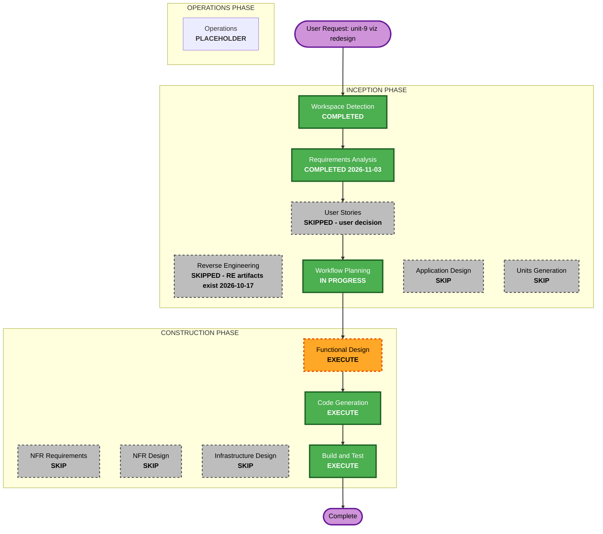

# Execution Plan - Unit 9 (Viz Redesign)

## Detailed Analysis Summary

### Transformation Scope (Brownfield)

- **Transformation Type**: Single component change (UI restyle) + additive backend extension + new build/test tooling
- **Primary Changes**: `src/agentic_dev_loop/viz/server.py` (PAGE string replaced per normative spec; `/topology` gains `flow`/`edges`); new viz frontend asset files wired to `frontend/scripts/lint-figma-primitives.mjs`; build step inlining assets into PAGE
- **Related Components**: `tests/test_viz.py` (contract tests updated for new DOM ids); `.opencode/skills/frontend-development/SKILL.md` (scope note); viz class register (new, unit-owned, linter-consumable)

### Change Impact Assessment

- **User-facing changes**: Yes - complete visual restyle of the viz page; behaviour frozen (rule zero, spec section 10)
- **Structural changes**: No - same module, same server, same endpoints (`/events` contract unchanged)
- **Data model changes**: No - `flow`/`edges` are derived DTO fields from existing `chain`/`back_edges`
- **API changes**: Additive only - `/topology` gains two keys; `mermaid` retained
- **NFR impact**: Yes - supply chain (pinned CDN, SRI evaluation), resiliency (CDN-unreachable fallback), repo ASCII policy on shipped assets

### Component Relationships

- **Primary Component**: `agentic_dev_loop.viz` (server.py, PAGE, topology_mermaid)
- **Shared Components**: none new (flow/edges derived in place)
- **Dependent Components**: tests/test_viz.py; frontend lint tooling; SKILL.md docs
- **Supporting Components**: none (no infra, no deployment change; stdlib-only runtime preserved)

### Risk Assessment

- **Risk Level**: Low-Medium (behaviour-preservation is the risk axis; mitigated by existing viz contract tests + spec section 12 checklist; new build step is build-time only)
- **Rollback Complexity**: Easy (single-module diff; old PAGE restorable from git)
- **Testing Complexity**: Moderate (DOM contract tests + pure-function layout invariants incl. PBT targets per NFR-6)

## Workflow Visualization

## Phases to Execute

### INCEPTION PHASE
- [x] Workspace Detection (COMPLETED - resumed existing project)
- [x] Reverse Engineering (SKIPPED - artifacts exist, viz module read directly)
- [x] Requirements Analysis (COMPLETED 2026-11-03 - FR-9.1..9.9, NFR-9.1..9.5)
- [x] User Stories (SKIPPED - user decision; spec sections 10-12 carry acceptance criteria)
- [x] Execution Plan (THIS DOCUMENT)
- [ ] Application Design - SKIP
  - **Rationale**: No new components/services; the normative design spec already is the application design (layout algorithm, component inventory, tokens, DOM contract). Changes stay within the viz component boundary.
- [ ] Units Generation - SKIP
  - **Rationale**: This request IS a single unit (unit-9); no decomposition needed.

### CONSTRUCTION PHASE
- [ ] Functional Design - EXECUTE
  - **Rationale**: Resolves the open design decisions: viz register location + linter wiring (FR-9.8), build-step mechanism for inlining assets into PAGE (NFR-9.1), SRI evaluation (NFR-9.2), class register content with mappings/justifications (FR-9.7), layout-invariant test harness and PBT targets (FR-9.9), ASCII treatment of prototype glyphs (NFR-9.5).
- [ ] NFR Requirements - SKIP
  - **Rationale**: NFRs already enumerated (NFR-9.1..9.5) with extension mapping; tech stack fixed by spec TS-4 (stdlib runtime, pinned Carbon CDN).
- [ ] NFR Design - SKIP
  - **Rationale**: No NFR patterns beyond spec'd behaviour (fallback, watchdog, reduced-motion); the one open item (SRI) is a Functional Design decision.
- [ ] Infrastructure Design - SKIP
  - **Rationale**: No infrastructure changes; stdlib-only runtime preserved.
- [ ] Code Generation - EXECUTE (ALWAYS)
  - **Rationale**: Implementation planning and code generation needed.
- [ ] Build and Test - EXECUTE (ALWAYS)
  - **Rationale**: Build, test, and verification needed.

### OPERATIONS PHASE
- [ ] Operations - PLACEHOLDER
  - **Rationale**: Future deployment and monitoring workflows.

## Estimated Timeline

- **Total Stages**: 3 to execute (Functional Design, Code Generation, Build and Test)
- **Estimated Duration**: FD: one focused session; CG: one to two sessions (page rebuild + topology + tests + lint wiring); BT: short

## Success Criteria

- **Primary Goal**: The viz page matches the normative design (spec + prototype oracle) with zero behaviour change
- **Key Deliverables**: restyled PAGE; `/topology` flow/edges; viz asset files + build step; viz class register; updated tests incl. layout invariants; SKILL.md scope note
- **Quality Gates**: full pytest suite green (incl. updated viz contract tests and em dash guard); viz assets pass lint-figma-primitives; spec section 12 acceptance checklist verified
- **Integration Testing**: viz contract tests against the live server; manual acceptance pass against the prototype oracle
