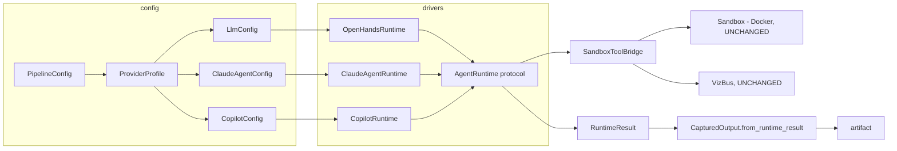

# Unit 10 Intent - Multi-provider runtime (OpenHands + Claude Agent + Copilot)

> **Status**: WONTSHIP 2026-11-06. The unit-10 code was reverted by the user
> (commit 526c802; see the unit-10 section of aidlc-docs/aidlc-state.md). The
> Copilot path is superseded by the 058 Copilot-as-endpoint direction (planning
> doc not yet written). This document remains as the historical record.
>
> STARTED 2026-11-05. Design produced and approved in a brainstorming session
> the same day ("OK, I agree with the design. STart a new AI-DLC unit and feed
> this into it"). This document records the intent, the verified facts, and the
> approved design that the AI-DLC unit fed on. No code written yet.

## Raw intent (user, verbatim, 2026-11-05)

- "Brainstorm. https://cellcog.ai/blog/opencode-claude-subscription/ Could we use a
  similar architecture to plug claude code agents into the agentic dev loop?
  Presumably we'd write our own claude code provider and swap out the OpenHands one"
- Q1 motivation: "Subscription cost savings"
- Q2 provider model: "Both, config-selectable (Recommended)"
- Clarified motivation: "My real motivation is to allow developers with Claude or
  Copilot subscriptions to leverage the agentic dev loop, specifically the
  kernel-level (docker) sandboxing and viz. OpenHands with its OpenAI support will
  always be a first-class option, but it will be swappable for CLaude or Copilot
  layers."
- Q3 scope: "Design both now"
- On thin drivers: "Thin is good. To summarise, OpenHands, Copilot and Claude would
  all use THE SAME TOOLS, right?" (confirmed: yes)
- "And DOcker sandboxing is preserved?" (confirmed: yes, with one new hardening
  requirement, see Design section)

## Distinction from unit-4 (WONTSHIP, do not confuse)

Unit-4 ("Claude Dynamic Workflows driver") was withdrawn by user directive
2026-10-22. That architecture put a Claude **dynamic workflow** (the Workflow tool)
in charge of the engine, with the engine exposed as an MCP toolkit. It was killed
because the Workflow tool's no-filesystem/no-shell sandbox forced every seam
(command gates, viz events, prompts) through agent mediation, diverging from
engine-mode guarantees.

This unit is the opposite shape: the engine stays in charge. A provider driver
runs the real `claude` CLI (or the Codex/Copilot runtime) as a subprocess, swaps
in the engine's own tools, and keeps every execution path on the existing
Sandbox.run and viz_bus seams. Kernel sandboxing and viz are preserved unchanged.

## Verified external facts (live-sourced 2026-11-05, not training data)

### OpenCode precedent (the architecture model)

- OpenCode 2.2.3 (Oct 30, 2026) ships a Claude Agent provider: it runs the real
  `claude` CLI through Anthropic's Agent SDK as a subprocess. It never reads or
  replays the saved login; Claude's built-in tools are OFF and OpenCode's own tools
  are swapped in; Claude keeps its own system prompt plus a note that it runs in
  OpenCode; subscription login shows cost $0.
- Policy gray area: Anthropic's SDK docs bar claude.ai login in third-party
  products unless previously approved. Jan 2026 account bans hit tools that
  SPOOFED Claude Code (not this pattern). Anthropic has not commented on OpenCode.
- GitHub announced (Jan 16, 2026) official support for using Copilot
  Pro/Pro+/Business/Enterprise subscriptions with OpenCode via formal partnership
  and a device login flow:
  https://github.blog/changelog/2026-01-16-github-copilot-now-supports-opencode/

### claude-agent-sdk

- Python package exists: `pip install claude-agent-sdk` (Python 3.10+). Spawns the
  Claude Code binary; options include allowed_tools, mcp_servers, can_use_tool,
  setting_sources, system_prompt, cwd, env, abort_controller, max_turns,
  permission_mode.
- IMPORTANT (security): the SDK auto-loads `.claude/` and `~/.claude/` skills,
  commands, memory, hooks. Project-level hooks are host-side code execution by
  default. Mitigation in our design: `setting_sources: []` plus `allowed_tools`
  locked to the engine catalog.
- Since June 15, 2026: Agent SDK and `claude -p` usage on subscription plans draws
  from a new monthly Agent SDK credit, separate from interactive limits. So
  subscription use is a credit bucket, not literally $0/unlimited.

### Anthropic legal constraints

- OAuth is intended for subscription purchasers' ordinary use. "Developers may not
  collect, store, or intermediate Claude.ai credentials or session tokens - sign-in
  must complete through Anthropic's own flow." Each end user must authenticate with
  their own credentials. The bar on offering claude.ai login in third-party
  products remains.
- Consequence for our design: the engine NEVER touches claude credentials. The user
  runs `claude login` themselves (Anthropic's flow); the engine detects the
  session and fails fast with guidance if absent.

### Copilot / Codex SDKs

- Codex SDK: `pip install openai-codex` (pinned Codex CLI runtime). Can be powered
  by an existing Copilot subscription (public preview per GitHub docs). Codex CLI
  auth: ChatGPT OAuth, device code auth, API key; `~/.codex/auth.json` caches login.
- GitHub Copilot SDK exists, with a "GitHub Signed-in User" OAuth device-flow auth
  method that requires a Copilot subscription; env token fallbacks
  (COPILOT_GITHUB_TOKEN, then GH_TOKEN, then GITHUB_TOKEN); BYOK alternative;
  stored OAuth credentials.
- The GitHub device flow is GitHub's own flow, so the engine MAY host it
  (prints code + URL, user completes in browser). No credentials are intermediated.

## Approved design (brainstorm output, user approved)

### Architecture: Approach A - runtime abstraction + per-provider SDK drivers

Thin drivers, fat shared bridge (user: "Thin is good"). One engine-owned runtime
protocol; three provider drivers; one shared tool catalog; one shared sandbox
bridge.

- Config: ProviderProfile gains `provider: openhands | claude-agent | copilot`.
  DEFAULT openhands, so an old config without the key behaves exactly as today
  (backward-compat test required). Config variants: LlmConfig (unchanged),
  ClaudeAgentConfig (login: subscription|key, model, max_turns), CopilotConfig
  (auth mode, model).
- AgentRuntime protocol (shared): `run(msg) -> RuntimeResult(final_text,
  truncated, status)`, `nudge()`, `close()`. RuntimeStatus enum:
  FINISHED | ERROR | STUCK | TRUNCATED.
- Three drivers:
  - OpenHandsRuntime: today's Conversation-driving body of stages.py MOVED in,
    behavior identical (pure refactor, must land green alone).
  - ClaudeAgentRuntime: claude-agent-sdk subprocess, async.
  - CopilotRuntime: codex/copilot SDK subprocess, async.
  - Async-to-sync bridge utility shared by the two subprocess drivers.
- SandboxToolBridge (shared): terminal -> Sandbox.run; forbidden rules, egress
  policy, secrets resolution, mounts, allowlist, timeout policy, infra-error
  classification, on_terminal_result -> viz events. Drivers contribute only a thin
  binding (tool-call adapter + observation format).
- ONE SHARED TOOL CATALOG (engine-owned): terminal, file_editor, task_tracker,
  finish. Same tools on ALL providers; .agent.md files 100% portable; the brief
  agent works everywhere. Bindings:
  - OpenHands: existing SDK tools (TerminalTool+SandboxTerminalExecutor,
    FileEditorTool, TaskTrackerTool, FinishTool).
  - Claude/Copilot: our MCP tools with native tools OFF (claude
    Bash/Edit/Write/Read/Glob/Grep/TodoWrite off).
  - Accepted trade-off: claude loses native file-tool polish (uniformity chosen
    over per-harness tools; the earlier read-only-tools hybrid was retracted).
- CapturedOutput gains `from_runtime_result()`; the old `from_agent_result` stays
  for OpenHands extraction. Redaction + artifact write shared.
- Docker sandboxing PRESERVED: all three providers execute only via the same
  Sandbox.run request path; the agent brain stays on the host (as today); harness
  model-channel egress unchanged; the sandbox egress policy still governs
  everything the agent executes.
- NON-NEGOTIABLE new hardening:
  - claude: `setting_sources: []` + allowed_tools locked to the catalog.
  - codex: no project config, no custom tools, our MCP only.
  - Secrets never into the harness process env.
  - Config-level fail-fast if a harness execution tool is not fully disabled.
  - Isolation verification checklist goes in the spec.
- Status mapping: openhands FINISHED->FINISHED, ERROR->ERROR, STUCK->STUCK;
  budget exhausted->TRUNCATED; subprocess death of claude/codex CLI->STUCK
  (no-flap, per the 030 infra-error policy).
- Dependencies as optional extras [claude]/[copilot]; configured-but-missing
  package fails fast. COMPAT-SHIMS.md entries + version-guard/canary tests for the
  new SDKs (same pattern as tests/test_sdk_compat.py).

### Old-world to new-world concept mapping (approved)

- LLM -> ProviderConfig
- build_llm + reasoning monkeypatch -> driver factory (reasoning gate OpenHands-only)
- .agent.md + AgentDefinition -> AgentSpec (engine policy: existence + name-match;
  interpretation per driver)
- Agent -> driver instance
- tools: frontmatter -> catalog names
- global tool registry + KD-4 re-registration -> catalog binding
- SandboxTerminalExecutor -> SandboxToolBridge
- TerminalObservation -> bridge result -> per-driver observation
  (TerminalObservation | MCP ToolResult)
- Conversation -> AgentRuntime
- send_message -> run(msg)
- conv.run() -> driver loop (openhands existing | claude async query() in thread |
  copilot thread/turn)
- ConversationExecutionStatus -> RuntimeStatus
- callbacks/_FinalizeNudgeController -> nudge() + engine nudge policy
- FinishTool -> catalog finish (openhands SDK infra | claude stream end | copilot
  turn end)
- ThinkTool -> harness-internal on claude/copilot
- FileEditorTool -> catalog file_editor (host-side file lane as today)
- TaskTrackerTool -> catalog task_tracker (claude TodoWrite off)
- get_agent_final_response -> per-driver final-text extraction
- CapturedOutput.from_agent_result -> from_runtime_result
- max_iteration_per_run -> per-driver budget (claude max_turns)
- SandboxError/STUCK -> unchanged + subprocess-death classification
- Sandbox / VizBus / on_terminal_result / secrets -> UNCHANGED (shared)

### Mermaid ERD (approved shape)

## Codebase anchor map (files this unit touches)

- src/agentic_dev_loop/core/config.py - ProviderProfile + per-provider configs
- src/agentic_dev_loop/engine/stages.py - Conversation-driving body moves into
  OpenHandsRuntime; runner switches to AgentRuntime.run
- src/agentic_dev_loop/engine/agents.py - SandboxTerminalExecutor becomes the
  SandboxToolBridge core; catalog bindings
- src/agentic_dev_loop/engine/outputs.py - CapturedOutput.from_runtime_result
- src/agentic_dev_loop/engine/isolation.py - unchanged (shared seam)
- src/agentic_dev_loop/engine/graph.py - unchanged (viz already engine-fed)
- src/agentic_dev_loop/engine/llm.py - build_llm stays OpenHands-only; driver
  factory decides
- pyproject.toml - optional extras [claude]/[copilot]
- COMPAT-SHIMS.md + tests/test_sdk_compat.py - new SDK shims + pinning tests

## Binding repo rules

- ASK BEFORE CODING: implementation is user-driven (as units 5 and 9 were).
- TDD red-green-refactor; mocks only at external network boundaries (SDK subprocess
  boundaries are mockable).
- No silent fallbacks; fail fast. Em dash (U+2014) banned in all committed files.
- Backward compat: config without `provider` behaves exactly as today.

## Open items carried into Requirements Analysis

1. Unit decomposition: one unit (staged code generation) vs split units
   (abstraction refactor first, then claude, then copilot).
2. Auth UX per provider: claude = user runs `claude login` (legal constraint),
   engine detects session; copilot = engine hosts GitHub device flow. Confirm.
3. Policy-risk stance for the claude provider (gray area, not the banned
   spoofing pattern): ship with documented risk note vs hold.
4. Missing design sections: per-provider data flow (message in, events out,
   final-response extraction, nudge loop mechanics) and the full status-mapping
   walkthrough were NOT presented before the user approved the design. They must
   be covered in the unit artifacts (requirements / functional design).
5. Ordering vs units 6-8 (cloud deployment, Linux-native sandboxing, parallel
   fan-out): all remain intent-only; this unit starts now per user request.

## Next steps (AI-DLC)

1. Requirements Analysis (standard depth) - clarifying questions inline in chat,
   answers written back to the question file.
2. Workflow Planning - stage selection for the unit.
3. Units Generation (if the unit splits) / Application Design (if needed).
4. Construction: Functional Design, NFR Requirements, Infrastructure Design,
   Code Generation (user-driven), Build and Test.
