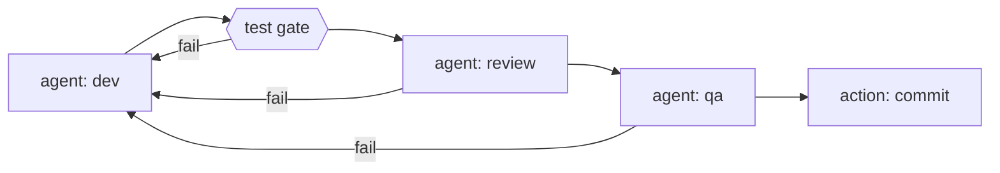

# Architecture overview

The loop is five layers. You author the first two; the engine owns the rest.

| Layer | What it is | Who authors it |
| --- | --- | --- |
| **Pipeline** | One `pipeline.yaml` declaring the stage graph: agent steps, mechanical command gates, verdict routing, retry loops, and per-step isolation. | You |
| **Agent prompts** | Markdown prompt files with YAML frontmatter (`<name>.agent.md`) defining each agent's role, rules, sandbox notes, and tools. | You |
| **Sandbox** | Every agent shell and command step runs in a Docker container: no network access by default, writes only to declared `mounts:`, and no `.git` - steps run against a fresh export. If no sandbox is available, the run stops instead of degrading. | Engine |
| **Dev image** | The digest-pinned dev image pulled on first run. The supply-chain check refuses to continue on a digest mismatch. | Engine |
| **Extensions** | Optional plugins: your own actions, tools, and document loaders, loaded from outside the workspace. | You (optional) |

Every run is crash-safe (interrupt and resume from the exact checkpoint),
watchable in a live browser graph view with a browsable run history, and
gated: nothing gets committed until every stage passes. The fixed policies
are part of the product - fail fast on missing config or secrets, no silent
fallbacks, verdicts only from artifacts, bounded retries, and a single
clean-worktree-gated commit point.

## What a run looks like

The shipped self-loop example is the canonical shape: an agent works, a
mechanical gate verifies, two verdict agents review, and a single host-side
action commits.

1. **dev** - the dev agent works with full context (loaded docs + shared files).
   Its edits are untracked; only declared `produces:` files are hygiene-tracked.
2. **test** - a mechanical command step runs the suite inside the sandbox.
   Exit 0 moves on; anything else rewinds to `dev` with the failing output.
3. **review / qa** - verdict agents finish by calling the `record_verdict`
   tool; the validated tool call routes the graph. `fail` rewinds to `dev`
   and consumes an attempt.
4. **commit** - the single commit point fires only when all gates passed and
   the worktree was clean at start.
5. **success** - committed; or **failure** when attempts are exhausted.

## Host boundary (security model)

The orchestrator, tool layer, and the `commit` action run in the host process
- they hold your credentials and your full user account, so the engine keeps
anything agent-writable out of that process:

- **Consumer actions are sandbox-executed.** An action you register via an
  extension is a command-shaped script (`script + params`), run through the
  same sandbox path as command steps. Only the engine's trusted built-ins
  (`commit`, document loaders) run host-side.
- **Extensions load from outside the workspace.** Any extension or tool
  module whose file resolves under the workspace is refused before import,
  naming the file.
- **The engine installs outside the workspace.** Install with pipx so the
  venv is unmounted from the sandbox; a startup self-check refuses to run if
  `agentic_dev_loop` resolves under the workspace.
- **Tooling is read-only by the loop.** At run start the pipeline file,
  `agents_dir`, `additional_files`, `aidlc-docs/`, and `tools/` must be
  git-clean relative to HEAD, and the `commit` action excludes those paths
  from its sweep, so the loop never commits its own tooling.
- **`commit` stays host-side, deliberately.** It holds push credentials and
  runs argv-style with a scrubbed child env and a hooks override, so repo
  hooks never execute.

Net: the host executes nothing from the workspace, reads only git-clean
control files, and the only agent-writable host-consumed thing left is the
code the loop is building.
