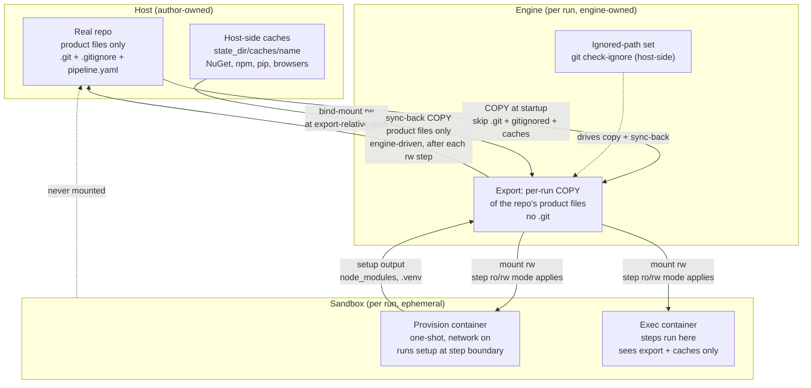
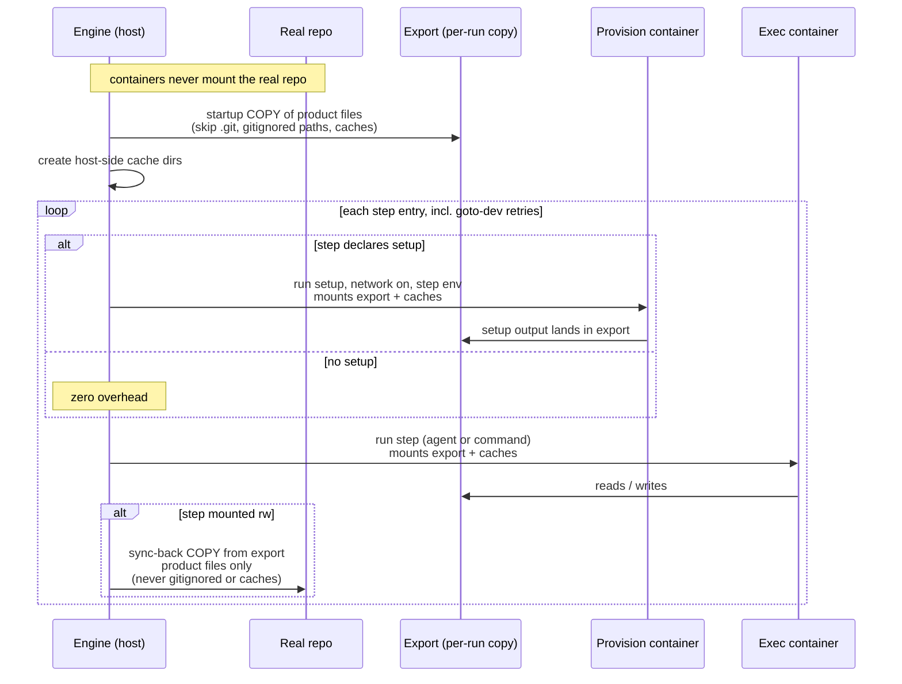

# 052: Per-run step-boundary setup, no stamping, host-side caches

> **Status: COMPLETED**

## Problem

Two engine issues, solved together:

1. **Setup is hoisted to startup and never runs at the step boundary.**
   `startup_sandbox` (engine/isolation.py 2106-2110) eagerly pre-provisions
   every declared `setup:` before the graph builds (graph.py 163-175 calls it
   the "zero infra mid-run" design). A dependency added mid-run by the dev
   agent leaves every later warm stale; the qa stage then fails ENV. This is
   deliberate, documented engine behavior (unit-3 BR-13, audit.md Q2), and it
   is wrong: placement of a setup on a step is purely declarative today.

2. **Build-dir poisoning.** The provision container mounts the real workspace
   (docker_provision_payload, isolation.py 821-846), so a setup like
   `cd frontend && npm ci` writes a Linux tree directly into the local-dev
   repo, flipping the host's darwin node_modules. Related: `sync_excludes`
   patterns like `**/bin/**` over-match `node_modules/**/bin/` dirs during the
   export copy, stripping every package bin dir from the export (the
   bin-stripping investigation that started this work).

The stamp/probe apparatus (016/028/045) exists to reconcile cross-run reuse of
warmed artifacts with the fact that those artifacts live in the real workspace
where the host can trample them. All three planning docs were patches on that
tension, and all three bug classes recurred anyway.

## Decisions

- **Approach 3: full per-run setup, delete stamping entirely.** User
  rationale: "We've had nothing but bugs in this area, and a few minutes
  rebuilding an env is trivial compared to a three hour dev cycle."
- **Pristine repo wins; per-run warm is fine.** Toolchain extraction dirs are
  never repo-resident.
- **All caches move host-side.** The repo becomes product files only; git
  status never shows toolchain state.
- **The engine becomes toolchain-agnostic.** Every Python-specific special
  case dies (see "venv" section). Python, npm, NuGet are all just toolchains.
- **Gitignore is the scratch definition.** The repo's own `.gitignore`
  decides what is local state for the copy and for sync-back; the engine
  hardcodes no toolchain names.

## Core model

1. **Setup runs at the step boundary, fresh, every time.** When a step with
   `setup:` starts (agent or command steps), the engine runs the hook in the
   provision container immediately before the step's first turn. Every entry
   re-runs it: first entry, `goto dev` retries, all of it. No stamping, no
   keys, no probes, no cross-run reuse. Setup failure keeps AE-SBX-009
   (loud halt, no stamp concept remains).

2. **The provision target is the export.** The provision container mounts the
   export root (plus host-side cache mounts) instead of the real workspace.
   Setup output lands in the per-run export. The repo is never written by any
   setup. Visibility is free: the exec container mounts the same export root.

3. **Startup eager provisioning is deleted.** Startup becomes: pull image,
   create exec container, materialize export, create host-side cache dirs.
   The "zero infra mid-run" invariant is reversed by design: one provision
   call per step entry is a sanctioned mid-run infra operation
   (implementation-spec.md guard test at 231/439 is updated).

**Ownership** (who owns what, and what is copied vs mounted):

**Run flow** (one step entry):

## Deletion list (stamp/probe apparatus)

- `read_stamp` / `write_stamp` / `clean_stamps` (isolation.py 1769-1786) and
  the `state_dir/stamps/` dir
- `setup_stamp_key` (509-516), `_lockfile_hashes` (1962-1974),
  `_declared_setups` (1985-1992); `_SKIP_DIRS` (1957-1959) and
  `_skip_scan_path` (1960-1961) die with their only consumer, `_lockfile_hashes`
- 045: `setup_probe` field (config.py 406), validators (467-471, 575-577),
  `_probe` (isolation.py 1184-1189)
- 016: venv probe trio (`venv_probe_command` 519, `venv_probe_argv` 548,
  `venv_probe_state` 554), `_probe_venv` (1191-1196), `remove_sandbox_venv`
  (577-609, AE-SBX-014)
- config `isolation.refresh` (229); CLI `--refresh` and `--clean-stamps`
  (cli.py 85-93, 188-192, import at 17)

## Provision mechanics

- One-shot `--rm` provision container per setup invocation, launched in the
  `_step_sandbox` seam before the step's first turn.
- Payload (docker_provision_payload): mount **export root rw** + host-side
  cache mounts; workdir = export root; network on; env = the declaring step's
  `env` block (so `npm_config_cache`, `PIP_CACHE_DIR` etc. resolve during
  setup).
- The exec container needs no restart: it mounts the export root, so files
  written by provision are visible the moment the step runs.
- Steps without `setup:` trigger nothing. Zero overhead.
- Setup on a ro-mounted step still writes to the export: provisioning is
  engine infrastructure and is not subject to the step's mount modes (same
  as today's startup provisioning).
- Setup remains constrained to agent and command steps (the current
  `setup AND (command or agent)` rule). Brief and action steps have no setup.

## Gitignore-aware copy and sync-back

The repo's own `.gitignore` is the engine's source of truth for what is
local state. No hardcoded toolchain names.

- The engine resolves the ignored-path set host-side via
  `git check-ignore --stdin -z` (covers `.gitignore`, `.git/info/exclude`,
  and global excludes) with default index-aware semantics: a tracked file is
  never ignored even if a pattern matches. One git subprocess per
  materialization and one per sync-back, all candidate paths batched over
  stdin.
- The export copy skips gitignored paths; sync-back never syncs them.
  A Rust repo's `target/`, a Python repo's `.venv`, the consumer's
  `node_modules`/`obj`/`bin` all disappear with zero engine knowledge.
- Pure plan functions stay pure (PBT-03): the ignored-path set is computed
  in the host caller and passed into `plan_step_workspace` /
  `plan_sync_back` as input data. The plan functions never touch git.
- Effects: the bin-stripping class dies by construction (gitignored dirs
  never enter the export, so `**/bin/**` cannot over-match them); the export
  flap dies; the AE-SBX-016 drift class dies for any gitignored artifact.
- `sync_excludes` and `caches:` remain author overrides for local state that
  is not gitignored (e.g. a report dir the repo keeps visible).
- `.git` stays engine-owned (always skipped by the copy, always forbidden
  by sync-back).
- No scratch-collision cache validator: declaring a cache on a gitignored
  path is now the normal, correct case. The consumer's node_modules cache
  deletion is documented cleanup, not an engine error.

## Host-side caches

- A declared cache resolves to `{state_dir}/caches/<name>/` where `<name>` is
  the declared relative path (`qa/.browsers` keeps its identity). Naming is
  global by declared name: stores are content-addressed by design (NuGet
  global packages, npm cacache, pip cache, playwright browser builds), so
  sharing across repos is correct and is the point.
- The host dir is `mkdir -p`'d at startup (idempotent infra op, NFR-5.4) and
  becomes `CacheMount.source`. The old checks flip: "cache path must exist in
  the workspace" (step_workspace.py 67-70) is deleted; `_caches_avoid_state_dir`
  (config.py 719-733) is deleted because caches now live under state_dir by
  design. `_mounts_avoid_caches` (738-753), `_excludes_avoid_caches`
  (757-772), and `_merge_avoid_excludes_and_caches` (777-793) stay.
- The in-container layout is unchanged, so `NUGET_PACKAGES=.nuget-packages`
  and `PLAYWRIGHT_BROWSERS_PATH=qa/.browsers` keep working untouched.
- Recommendation for per-run warms: declare neutral stores so the per-run cost
  stays in minutes. The consumer's `.nuget-packages` already does this; add an
  npm cache (declared cache dir + `npm_config_cache` env) and, for the dogfood
  pipeline, a pip cache (`PIP_CACHE_DIR`).

## Venv: no engine-level special case

The engine currently carries a Python-specific apparatus. All of it dies:

- `SANDBOX_VENV_DIR` / `SANDBOX_VENV_PYTHON` constants (87-88),
  `resolve_sandbox_venv_dir` + AE-SBX-015 (488-506), the `sandbox_venv_dir`
  threading through `docker_create_payload` (702-767, relocated-venv mount at
  759-763) and `docker_provision_payload` (823-839), and the startup mkdir
  (996-1001)
- the read-only tmpfs mask over the host `.venv` in `_sandbox_mounts`
  (681-695; dead once provision mounts the export)
- `repair_venv_shebangs` (613) and its startup call (2087) - a venv built
  fresh in the current export bakes the correct path by construction
- config field `sandbox_venv_dir` (240) with its comment (235-237), the
  `_sandbox_venv_not_declared_cache` validator (803-812),
  `HOST_ONLY_MOUNT_DIRS` (config.py 21) with its validator uses (73, 105),
  and `HOST_ONLY_DIRS` (isolation.py 92, used at 692)
- `.venv` entries in `_EXCLUDED_DIRS` (step_workspace.py 24) and `_FORBIDDEN`
  (sync_back.py 28), replaced by gitignore-awareness (the repo's own
  `.gitignore` excludes them)

Loading a pipeline that sets `isolation.sandbox_venv_dir` fails loudly with a
migration message ("venvs are per-run, built by a setup hook into the export;
remove this key"). No warn-and-ignore.

After this design the engine never treats Python differently from any
toolchain: a venv is just a gitignored directory in the export, exactly
parallel to `node_modules` or a Rust `target/`. A venv build is author YAML
(a setup on the step that needs it), identical in shape to
`cd frontend && npm ci`. Acceptance grep guard: no "venv" string in `src/`
at all, docstrings aside. `.venv-sandbox` exclusion comes from the dogfood
repo's own `.gitignore`.

## Error handling and edge cases

- Provision failure at step entry: AE-SBX-009, halt. Same behavior as today's
  startup failure, no regression; a setup failure is engine infrastructure
  failing, not a step verdict, so it does not route through `on_fail`.
- `goto dev` retry: provision re-runs fresh on every entry. Correct by
  construction (a mid-run dependency add is picked up on the retry) and
  accepted cost.
- Concurrent runs: exports are per-run (already true). Host-side caches are
  shared across runs, the same property the real-workspace caches had today;
  content-addressed stores tolerate concurrent access. Accepted risk,
  unchanged from today.
- sync_back dangling-symlink tolerance (sync_back.py 148): re-verify whether
  its only justification was toolchain dirs; tighten if gitignore-awareness
  removed the real cases.
- `git check-ignore` failure (git missing, or the workspace is not a git
  repository): loud failure before materialization and before sync-back.
  Pipelines run in git repos with a commit action; a workspace without
  `.git` is not a supported configuration and is never silently degraded.
- Backward compatibility (repo rule: explicit delete instructions): the
  migrations below name every repo-resident dir to delete by hand before
  upgrading, and removed config keys fail loudly with migration messages.

## Pipeline migrations

Consumer repo (applied after the engine ships):

- `caches:` shrinks to `[.nuget-packages, qa/.browsers]`; the three
  node_modules entries are deleted (gitignore covers them).
- Delete the `frontend-warm` step; `review.on_pass` returns to `qa`.
- `qa.setup` stays `cd frontend && npm ci`; `setup_probe` is deleted
  (unsupported field).
- Dev's setup stays as-is (runs fresh per dev entry into the export).
- Rewrite the linux-flip caveat comments and the env_fact "package fetches
  run only in the network-on pipeline steps" (setups now run fresh at step
  start with network in the provision container; agents still never fetch).
- Manual cleanup before upgrading: `rm -rf` the repo-resident
  `.nuget-packages`, `qa/.browsers`, `qa/node_modules`, `frontend/node_modules`,
  `frontend-editor/node_modules`. New state lives under
  `~/.agentic-dev-loop/state/caches/`.
- Optional: npm cache declaration + `npm_config_cache` env to keep per-run
  `npm ci` to minutes.
- Verify the repo `.gitignore` covers every local-state dir (`node_modules/`,
  `obj/`, `bin/`, `TestResults/`, `.tmp/`, etc.); the `**/bin/**` and
  `**/obj/**` `sync_excludes` entries become redundant wherever gitignored.
  Keep `sync_excludes` only for non-gitignored local state.

Dogfood repo:

- Remove `isolation.sandbox_venv_dir`.
- Move the venv-build setup from the test step to the dev step (dev agents
  run python in-sandbox, and restore precedes test and needs
  `.venv-sandbox/bin/python`). Test's setup is deleted.
- Optional: pip cache declaration (`PIP_CACHE_DIR`) so the per-run venv
  rebuild is mostly wheel extraction.
- Ensure `.gitignore` covers `.venv-sandbox` (and any other local-state
  dirs).

## Tests (red-first)

- Provision timing: called once per step entry before the first turn;
  re-called on goto-dev retry; skipped when no setup; AE-SBX-009 halts rather
  than routing on_fail.
- Provision payload: export root + host-side cache mounts + step env block;
  workdir = export root; network on.
- Gitignore-aware: copy plan skips gitignored paths; sync-back skips them;
  a tracked file that matches a pattern still copies and syncs; negative
  patterns are honored; the pure plan functions receive the ignored set as
  input data; the git subprocess runs once host-side, batched.
- Host-side caches: missing workspace path is fine; host dir created; mount
  source = `state_dir/caches/<name>`.
- Config: reject `setup_probe`, `isolation.refresh`, and
  `isolation.sandbox_venv_dir`; accept host-side cache names (no
  scratch-component rejection; cache declarations on gitignored paths are
  legal); keep `_mounts_avoid_caches` etc.
- Grep guards: no stamp functions, no `--refresh` / `--clean-stamps`, no
  `setup_probe` in src; the venv-in-src guard above.
- implementation-spec "zero infra mid-run" guard test reversed: provision is
  the one sanctioned mid-run infra call, once per step entry.
- Delete the 016/028/045 test files; update unit-5 pure-plan tests and
  sync-back tests.

## Docs

- New design doc: this file.
- business-rules.md: rewrite BR-13 (setup at step boundary, fresh, export
  target); update BR-3.1/3.2 (host-side caches); new rules for gitignore as
  the source of truth for copy/sync-back, and step-boundary provision
  ordering.
- implementation-spec.md: update the 231/439 guard test note.
- docs/setup.md: sections 3 and 5 (sandbox venv, provisioning).
- CHANGELOG.md: Breaking section (setup timing/target, host-side caches,
  removed keys: setup_probe, isolation.refresh, isolation.sandbox_venv_dir,
  removed CLI flags: --refresh, --clean-stamps, gitignore-aware
  copy/sync-back).
- Mark planning-docs 016, 028, 045 SUPERSEDED in their headers (history
  untouched).
- aidlc audit.md: append a log line during implementation.

## Deferred (explicitly out of scope)

- Cache pruning/GC tooling; manual `rm -rf` under the caches dir is the
  documented mechanism for now.
- Per-workspace cache keying (chose global-by-name).
